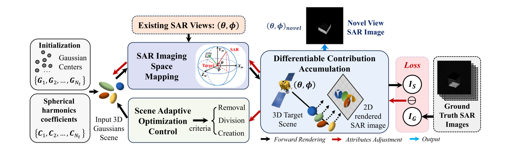
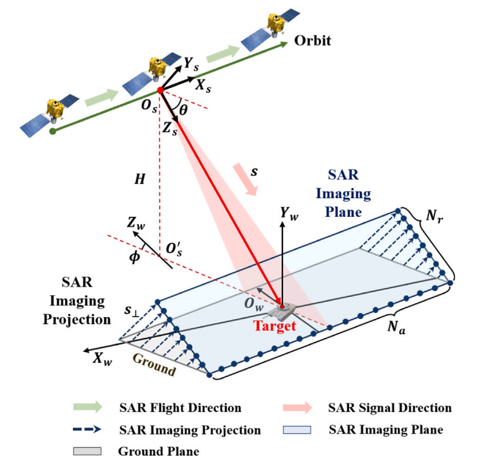
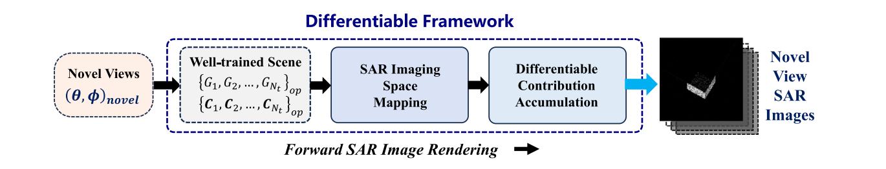
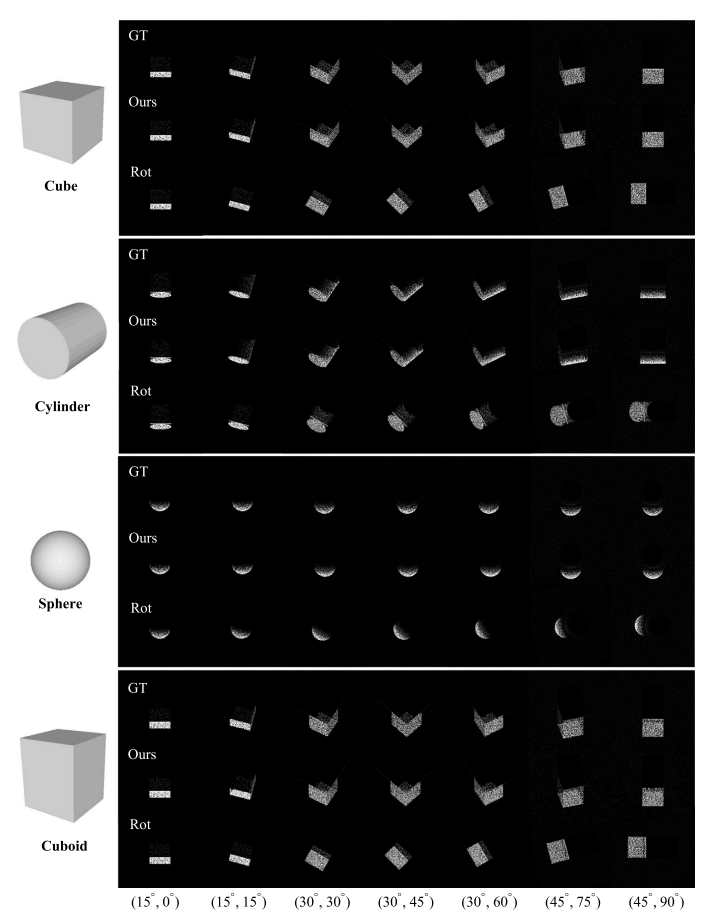

# 10.12 周报

主要进行了A differentiable method for novel view SAR image generation via 3D Gaussian Splatting 论文阅读以及论文框架图的学习绘制

## 摘要

**问题：**SAR 目标图像受观测几何限制，往往缺少足够的视角覆盖；而SAR图像具有明显的视角各向异性，直接用普通图像增强或GAN补图不一定能保持真实的散射和噪声特征。

**方法：**将SAR成像机制与3D Gaussian Splatting（3DGS）结合。用独立的3D高斯表示目标几何，用球谐函数表示散射强度随观察方向的变化；再根据映射与投影算法（MPAs）把目标场景变换到SAR传感器坐标系，并沿SAR投影方向进行可微的散射贡献累积，直接生成像素域SAR图像。渲染结果和已有视角的真实图像比较后，通过反向传播优化高斯的位置、协方差和球谐系数。

**结果：**在OptiXSAR模拟数据和MSTAR实测数据上，方法能够生成未观测视角的SAR图像，并在少样本分类增强实验中优于GAN方法、SAR-NeRF和SAMPLE。论文报告的下游识别性能提升分别为7.42%、19.0%和9.92%；这些数字对应论文中的特定实验设置，不宜理解成对所有数据集都成立。

## 1. 引言

**背景：**SAR具有全天时、全天候的主动观测能力，深度学习已经用于SAR图像解释和目标识别。但现有数据通常受平台入射角和观测轨迹限制，难以覆盖完整视角；同一目标在不同视角下的散射强度、目标分布和背景纹理也可能明显变化。

现有路线有三类问题：

- **基于物理的SAR仿真**可控、可解释，但真实场景中目标介电常数、精确几何模型和表面粗糙度通常难以获得，仿真图像不一定和真实SAR图像充分一致。
- **GAN类方法**可以直接学习多视角图像分布，但缺少显式属性和散射机制，视角外推时容易出现目标失焦、背景失真或噪声模式不真实。
- **可微渲染**能把3D到2D的过程纳入梯度优化，但基于网格的方法依赖准确的网格重建，NeRF类方法在少视角下的推断能力有限。

本文的思路是：用3DGS的显式表示保留目标的独立空间元素，同时把SAR的成像几何和散射累积方式写进可微渲染过程。

**贡献：**

1. 提出一种面向新视角SAR图像生成的可微方法，从已有多视角SAR图像中学习目标几何和不同视角下的散射强度分布。
2. 构建基于3DGS的可微SAR图像渲染框架，包括3D高斯与球谐组成的场景表示、SAR成像空间映射和可微贡献累积。
3. 在模拟数据和MSTAR实测数据上验证多视角表示、新视角生成和少样本识别增强效果。
4. 与GAN方法、SAR-NeRF比较，论文报告了图像质量、生成效率和下游识别方面的优势。

## 2. 相关工作

### 2.1 基于物理的SAR仿真

​	这类方法把电磁散射计算和SAR成像原理结合起来，可分为**原始数据仿真**和**图像仿真**。前者生成SAR回波或原始数据，后者直接生成反射率图或SAR图像。

​	原始数据方向包括SARAS、双基地SAR原始数据模拟、BART和基于射线追踪的方法；图像方向包括RaySAR、CohRaS、SARViz、MPA成像仿真、OptiXSAR等。它们通常有较好的物理可解释性和参数可控性，但依赖目标模型、散射参数和成像参数，复杂场景的建模与计算成本也较高。

​	本文方法生成的结果在形式上更接近SAR图像仿真，但不要求精确的电磁模型，而是从已有多视角图像中学习目标表示。

### 2.2 基于GAN的方法

​	SAR图像生成中常见的GAN包括cGAN、WGAN、DCGAN、InfoGAN以及加入自编码器的变体。它们可以通过对抗学习和重建损失生成用于数据增强的样本，一些工作也加入了SAR成像几何或物理先验。

​	但很多方法仍缺少显式的物理散射机制和成像约束，并且通常需要较多训练数据。少样本和大视角外推时，可能出现模式坍塌、目标区域失焦、背景变形或人工噪声。本文将SNGAN、LSGAN、DRAGAN和WGAN-GP作为GAN对比方法。

### 2.3 可微渲染方法

​	可微渲染通过近似或重写渲染过程，使3D场景到2D图像的过程可以用梯度下降反向优化。OpenDR、Soft Rasterizer等方法主要处理光栅化的可微近似；也有工作把SAR物理机制加入网格渲染器，例如Differentiable SAR Renderer（DSR）。

​	基于NeRF的SAR-NeRF和Radar Fields用隐式场表示目标，但在少视角和大角度推断时能力有限。网格方法还受网格重建精度限制，背景噪声通常需要额外建模。

​	3DGS同时具有显式表示和快速渲染的特点。本文进一步把SAR成像几何、散射属性和贡献累积过程融入3DGS，形成面向SAR新视角生成的可微框架。

## 3. 方法

### 3.1 整体框架

输入包括：

- 已有视角$(\theta,\phi)$下的SAR图像；
- 一个由高斯中心初始化的3D目标场景；
- 每个3D高斯对应的球谐散射系数。

先把目标场景映射到与SAR成像平面对齐的正交传感器坐标系，再把高斯投影到SAR成像平面，沿投影方向累积散射贡献，得到渲染图像。渲染图像与真实SAR图像之间的损失用于反向调整目标场景属性。训练完成后，将新的$(\theta,\phi)$输入同一套前向渲染过程，即可生成新视角SAR图像。

图1：黑色箭头表示前向渲染，红色箭头表示属性调整，蓝色箭头表示输出。框架还会根据梯度进行高斯的移除、分裂和创建。

**整体流程：**已有视角和初始化高斯 → SAR成像空间映射 → 可微贡献累积 → 与真实图像比较 → 反向优化高斯属性 → 输入新视角并前向渲染。

### 3.2 基于MPA的SAR成像几何

​	SAR通过脉冲压缩和合成孔径形成二维高分辨率图像。论文采用Mapping and Projection Algorithms（MPAs，映射与投影算法）描述目标散射贡献如何落到SAR成像平面上。

​	**坐标关系：**目标场景使用世界坐标系$O_w-X_wY_wZ_w$，SAR传感器使用$O_s-X_sY_sZ_s$。$Z_s$沿视线方向，雷达平台沿方位方向飞行，$H$为平台高度；$\theta$是俯仰/高程角，$\phi$是方位角，$\mathbf{s}$是雷达信号传播方向，$\mathbf{s}_\perp$与其垂直。

​	在远场条件下，入射雷达信号可以近似为平行射线。MPA把目标场景沿方位方向分成若干条线，将每条线上的散射贡献沿$\mathbf{s}_\perp$投影到等效SAR成像平面。该平面包含$N_a$个方位单元和$N_r$个距离单元，最终每个单元对应SAR图像的一个像素。

​	图2：散射贡献在等效SAR成像平面上累积。这里的成像平面是为了把SAR投影关系写成可微的像素域操作。

### 3.3 目标场景表示

目标场景由两类属性组成：

- **几何属性：**用独立、可优化的3D高斯表示目标元素的位置、范围和方向；
- **散射属性：**用球谐系数表示每个目标元素的散射贡献随观察方向的变化。

这种表示不直接恢复网格法线，也不显式求解完整电磁散射模型，而是让几何和散射参数从已有多视角SAR图像中共同优化。

#### 3.3.1 基于3D高斯的几何属性

​	一个3D高斯由中心位置和协方差决定：

$$
G(\mathbf{x})=
\frac{1}{|\boldsymbol{\Sigma}|^{1/2}(2\pi)^{3/2}}
\exp\left[-\frac12(\mathbf{x}-\mathbf{p})^T
\boldsymbol{\Sigma}^{-1}(\mathbf{x}-\mathbf{p})\right].
$$

​	$\mathbf{p}$是高斯中心，$\boldsymbol{\Sigma}\in\mathbb{R}^{3\times3}$控制空间范围和方向。目标场景由$N_t$个可优化高斯组成。

​	3D高斯既能表示局部强散射点，也能表示分布式散射区域；它的二维投影有解析形式，便于后续投影和贡献累积。相比网格表示，它不需要估计或维护表面法线。

#### 3.3.2 基于球谐的散射属性

​	SAR散射受目标几何、材料、位置和工作模式影响，并且随观察角度显著变化。为了在可微框架中表达这种角度各向异性，论文不直接嵌入复杂且可能不可微的电磁散射模型，而是用球谐函数作为正交基，对每个高斯的散射贡献进行多项式拟合：

$$
s_i(\theta,\phi)=
\sum_{l=0}^{L}\sum_{m=-l}^{l}
C_{l}^{m}Y_{l}^{m}(\theta,\phi).
$$

​	$s_i(\theta,\phi)$是第$i$个高斯在观察角$(\theta,\phi)$下的散射贡献，$C_l^m$是可学习的球谐系数，$Y_l^m$是球谐基函数，$L$是最高阶数。论文在实数域中建模，因为最终输出是SAR强度图像。

​	SAR散射具有较强的高频变化，高阶球谐更有利于拟合视角变化，但阶数越高计算量也越大。因此论文选择在拟合能力和可微框架效率之间折中，使用可行的最高阶数。

### 3.4 前向SAR图像渲染

#### 3.4.1 SAR成像空间映射

​	同一个目标在不同视角下对应的SAR成像平面和传感器位置都不同，因此不能直接在固定世界坐标中累积。框架先将3D高斯从世界坐标变换到与成像平面对齐的正交传感器坐标。

​	给定视角$(\theta,\phi)$，先根据视角计算旋转矩阵$\mathbf{R}$和位移向量$\mathbf{t}$，把高斯中心从世界坐标变换到传感器坐标：$\mathbf{p}_i^s=\mathbf{R}\mathbf{p}_i^w+\mathbf{t}$。然后用投影的局部雅可比矩阵$\mathbf{J}$变换协方差，得到二维投影高斯；其中心由传感器坐标中的$(x_s,y_s,z_s)$确定，二维协方差取投影协方差对应的$2\times2$部分。

​	所以高斯的空间范围和方向会随观察视角一起变换，而不是简单地把图像做平面旋转。

#### 3.4.2 可微贡献累积

​	记SAR成像平面中的一个像素单元为$\mathbf{r}^{(n_a,n_r)}$。每个3D高斯投影后形成一个二维高斯分布$f_i$，沿$\mathbf{s}_\perp$方向按顺序累积；前方高斯通过透射率$\prod_{j<i}(1-f_j)$影响后方高斯。像素强度可概括为：$I_E=\sum_i s_i f_i\prod_{j<i}(1-f_j)$。

​	这个过程不是先生成回波再做完整时域相干累积，而是利用投影几何直接在像素域累积散射贡献；每一步都是可微的。

​	图5：多个3D高斯沿$\mathbf{s}_\perp$方向把散射贡献累积到SAR成像平面上的像素。

### 3.5 目标属性反向调整

​	前向渲染得到$\mathbf{I}_E$后，与已有视角的真实图像$\mathbf{I}_G$比较。损失由强度误差和结构误差组成：$\mathcal{L}_{\mathrm{total}}=\alpha\mathcal{L}_{1}+\beta\mathcal{L}_{\mathrm{D\text{-}SSIM}}$，其中$\alpha+\beta=1$。

​	$\mathcal{L}_1$约束像素强度，$\mathcal{L}_{\mathrm{D\text{-}SSIM}}=1-\mathrm{SSIM}$约束局部结构。论文没有在式（22）中固定写出$\alpha$和$\beta$的数值，而是在第4.2节给出具体损失实现。

**梯度更新：**通过链式法则把图像损失传回高斯中心、协方差和球谐系数，再用梯度下降更新。协方差的更新同时调整高斯空间范围和方向，避免直接优化一个不受约束的协方差矩阵。

**自适应场景优化：**属性优化进行到中间阶段后，根据梯度和高斯大小执行：

- 可见性不足或空间范围过大的高斯被移除；
- 梯度较大且高斯较大时，将其分裂成多个更小高斯，补充细节；
- 梯度较大但高斯较小时，复制高斯，补充覆盖不足的区域。

这种操作和原始3DGS中的密度控制作用相近，但这里的优化信号来自SAR图像损失，目标是同时补充几何覆盖和视角相关散射表示。

### 3.6 新视角SAR图像生成

训练收敛后，优化好的高斯几何属性和球谐散射属性共同构成目标场景表示。给定新视角$(\theta,\phi)_{\mathrm{novel}}$，按以下四步生成图像：

1. 输入新视角角度；
2. 将3D高斯场景映射到该视角的SAR成像空间；
3. 将各高斯的散射贡献投影并累积到SAR成像平面；
4. 输出新视角SAR图像。

论文把训练视角之外的角度都称为新视角，其中既包括训练角度范围内的**插值**，也包括范围外的**外推**。

图6：训练好的场景表示只需接收新视角角度，即可重复前向SAR图像渲染。

## 4. 实验与结果

​	实验使用MSE、PSNR、SSIM和LPIPS评价图像质量：MSE和LPIPS越小越好，PSNR和SSIM越大越好。

​	OptiXSAR先用于四种标准几何目标：立方体、圆柱体、球体和长方体。每个目标包含3个高程角（$15^\circ$、$30^\circ$、$45^\circ$）和24个方位角，共72个视角；图像大小为$200\times200$，空间分辨率和像素大小均为$0.2\,\mathrm{m}\times0.2\,\mathrm{m}$。四种目标的平均PSNR均超过28 dB，平均SSIM均超过0.96，平均LPIPS均低于0.15。这里主要验证标准几何目标上的渲染能力，不能直接等同于复杂真实目标的生成性能。

​	GT是真实模拟图像，Ours是本文方法渲染结果，Rot是旋转增强结果。旋转可能改变目标分布、形状和位置，不能替代带成像几何约束的新视角生成。

### 模拟数据

​	复杂目标包括Van、T-72、Sacramento、Falcon-8X、Building-1和Building-2。训练使用高程角$15^\circ$、$30^\circ$、$45^\circ$下的72个视角，测试包括高程插值$17^\circ$和高程外推$47^\circ$，方位角间隔为$30^\circ$。不同目标使用的图像大小和空间分辨率不同，论文按目标尺度分别设置。

​	复杂目标实验的平均SSIM超过0.91、MSE低于0.006、LPIPS低于0.3、PSNR超过22 dB。高程范围内的插值整体更稳定；外推仍能保持基本目标形状，但结构重叠、阴影和背景噪声更难预测，且目标越复杂、尺寸越大，生成难度越高。

​	论文还测试了生成样本对目标识别的帮助：8类船舶和8类飞机分别使用10张真实图像，再加入10、20或30张生成图像训练ResNet50和ShuffleNet。生成样本增加后，两类目标的识别率都提高；在论文给定设置中，最高相对提升为船舶ResNet50的22.30%和飞机ResNet50的29.65%。这些结果只说明该实验设置下的数据增强有效，不能泛化到所有分类任务。

### MSTAR实测数据与对比

​	MSTAR包含10类目标，论文使用$17^\circ$高程角训练、$15^\circ$高程角测试，训练集和测试集分别为2747和2426张，图像大小为$128\times128$。每类选取24张训练图像生成$15^\circ$高程角的新视角，平均结果为PSNR 28.20 dB、SSIM 0.901、LPIPS 0.153、MSE 0.0019。不同类别之间仍有差异，说明实测数据上的生成质量并不完全一致。

论文进一步在不同设置下与几类方法比较：

- **电磁仿真：**在六类MSTAR目标上，本文方法平均PSNR为28.96 dB、SSIM为0.897、LPIPS为0.122、MSE为0.0014，高于两种电磁仿真方法。电磁方法一次生成一个视角约需2.43–6.45分钟；本文方法在24个训练视角下的生成过程少于3.2分钟。两者依赖的数据和技术路线不同，不能只按单一指标判断。
- **GAN：**在论文的训练配置下，本文方法总训练时间低于0.6小时，GAN通常接近或超过1小时；少样本分类和跨高程测试中，本文方法整体更稳定，但效果仍受输入视角数量和目标类别影响。
- **SAR-NeRF：**在2S1目标实验中，本文方法的平均PSNR/SSIM/LPIPS/MSE为30.79 dB/0.878/0.199/0.0010，SAR-NeRF为26.85 dB/0.829/0.284/0.0021。远离训练视角时，SAR-NeRF更容易出现失焦和雾状伪影。
- **SAMPLE：**在五类目标的比较中，本文方法平均PSNR/SSIM/LPIPS/MSE为30.79 dB/0.913/0.078/0.0012，SAMPLE为26.62 dB/0.848/0.206/0.0025。分类增强结果也更好，但生成视角限制在$10^\circ$到$80^\circ$，不能代表完整方位覆盖。

这些对比支持本文方法在所设数据和实验条件下的有效性，但优势依赖训练视角、目标类别、比较方法和评价设置。

## 5. 讨论

本文针对有限视角和视角变化下的SAR新视角图像生成，核心优势来自三点：

1. **显式目标表示：**独立3D高斯更容易表达离散强散射响应，也能直接控制空间位置、范围和方向。
2. **视角相关散射：**球谐系数拟合每个目标元素随$(\theta,\phi)$变化的散射贡献，比固定强度更适合SAR的角度各向异性。
3. **SAR成像约束：**MPA成像空间映射和沿投影方向的贡献累积，使生成过程和SAR成像几何保持一致。

​	与GAN相比，本文方法对训练样本量要求较低，生成结果的背景杂波和斑点噪声更稳定；与SAR-NeRF相比，显式高斯更适合表达离散散射点和大角度变化；与EM仿真和SAMPLE相比，不依赖精确的3D CAD模型和人工参数调节。

**局限与后续方向：**

- 方法仍然是从数据中学习散射表示，并没有完整显式地建模电磁散射机制，物理可解释性仍有限。
- 每个像素沿投影方向需要遍历相关3D高斯，场景变大后贡献累积仍可能成为效率瓶颈。
- 论文计划进一步加入显式SAR散射建模和正则化，扩展到多目标、大规模场景和智能PolSAR数据生成。
- 训练视角不足或新视角离训练范围较远时，目标细节、阴影和背景噪声仍可能出现偏差；论文中的外推结果只能说明在所测目标和角度上的可行性。

## 6. 结论

​	论文提出了一种结合SAR成像机制和3DGS的可微新视角SAR图像生成方法。该方法从已有多视角数据中学习目标几何和散射强度分布，用独立3D高斯表示目标场景，用球谐函数表示多视角散射贡献，并通过SAR成像空间映射和MPA式贡献累积生成像素域SAR图像。

​	在模拟数据和MSTAR实测数据上的实验表明，方法能够进行高质量的高程插值、一定程度的高程和方位外推，并能在少样本分类中提供有效的数据增强。它在实验中优于GAN方法、SAR-NeRF和SAMPLE，但优势依赖于数据、训练视角和评价设置。总体上，本文展示了3DGS向SAR图像生成领域迁移的一种可行方式。
