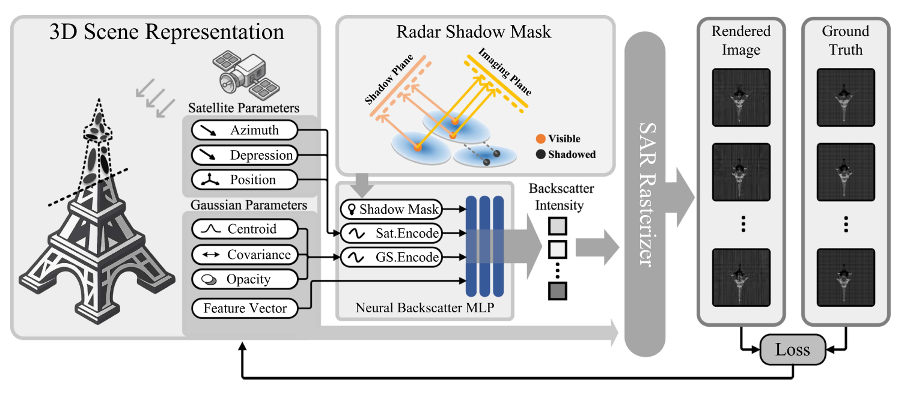
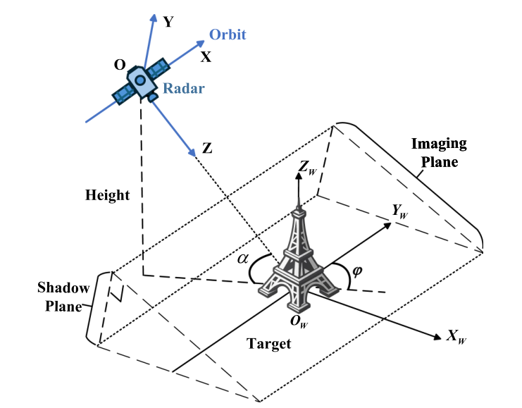
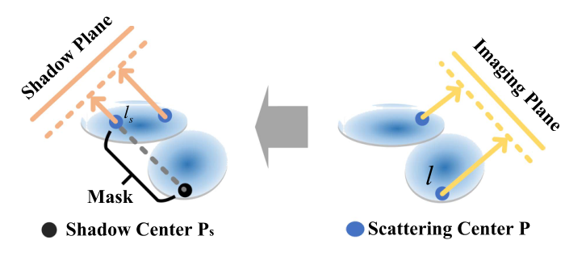
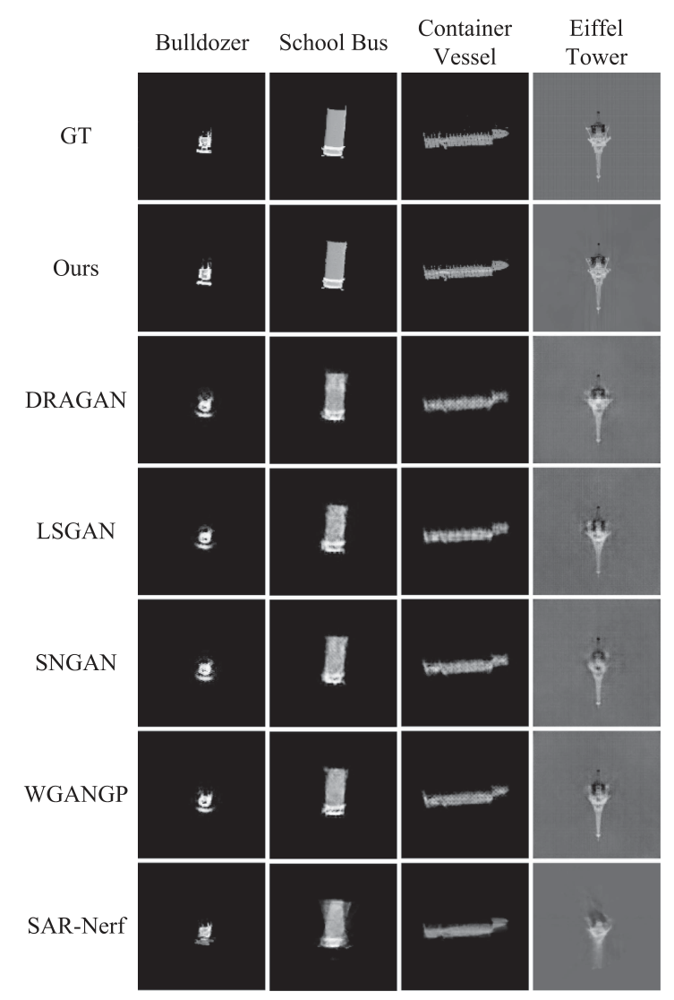
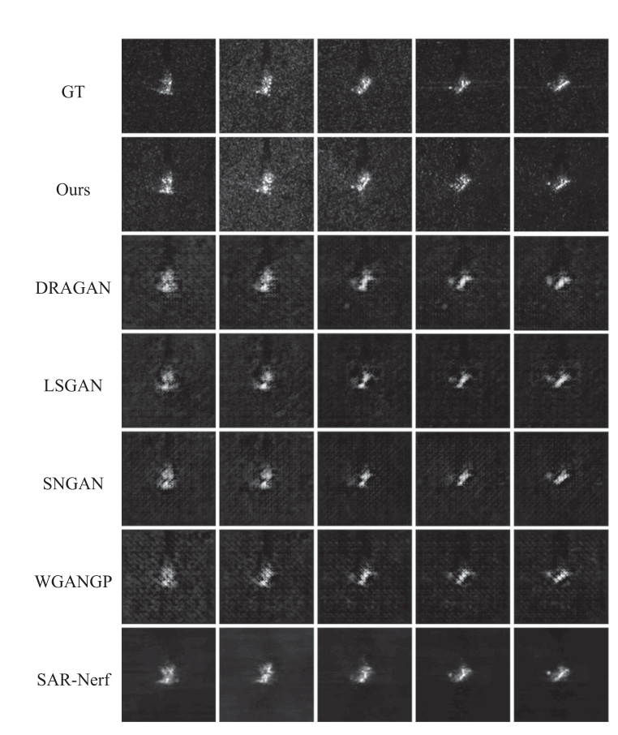
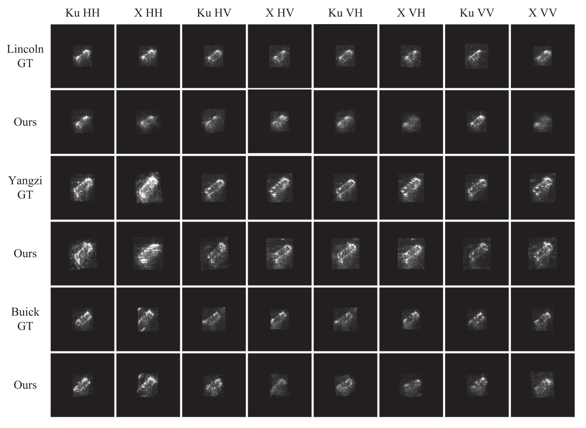
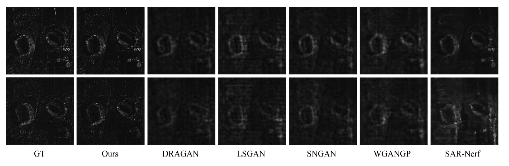
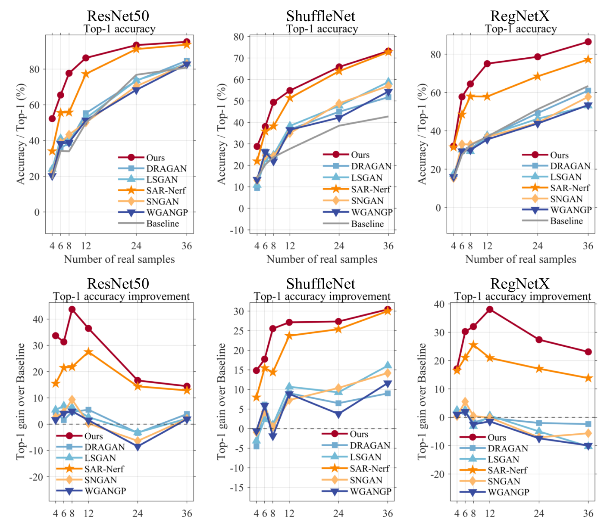
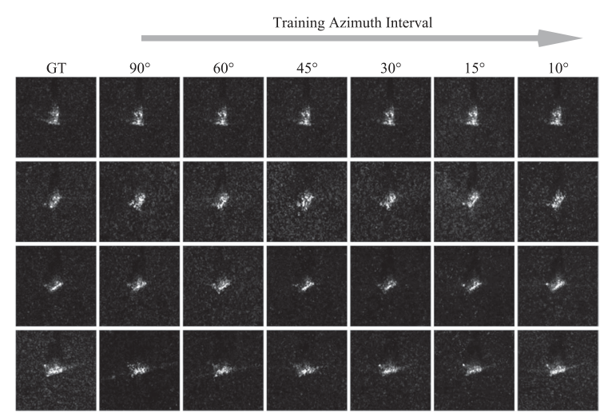
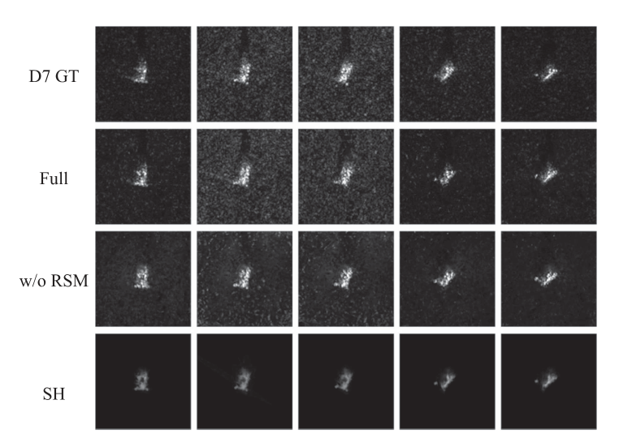

# 10.19周报

本周精读论文A Visibility-Aware Neural Gaussian Framework for SAR Image Generation and Data Augmentation，论文研究从少量已观测视角生成新视角 SAR 强度图，并检验生成图像能否用于目标识别的数据增强。

## 摘要

**问题：**SAR 图像的散射强度和阴影随视角变化明显，未观测视角的生成比较难。已有数据驱动方法在优化效率和物理可解释性上仍有不足。

**方法：**把 SAR 斜距投影几何放进端到端可微框架，用“神经后向散射高斯”表示场景：高斯负责空间结构，可学习特征向量和条件多层感知机（MLP）负责预测不同视角的后向散射强度；雷达阴影掩码（RSM）提供自遮挡约束。渲染图像与真实图像比较后，联合优化场景和网络参数。

**结果：**论文在 RaySAR 仿真、MSTAR/ATRNet-STAR 实测目标及 Umbra 复杂场景上报告了更好的生成质量和更短的训练时间。三种分类器的少样本增强实验中，生成图像带来的平均 Top-1 准确率提升为 **27.1 个百分点**；这是论文所用数据、划分和分类器下的结果。

## 1. 引言

**背景：**SAR 可以全天时、全天候成像，但斜距投影、各向异性散射和自阴影会让同一目标在不同方位角下呈现不同的亮点、轮廓和阴影。实测视角有限，单靠图像统计关系生成新视角，容易出现散射点漂移和阴影不一致。传统仿真需要准确的三维几何、材料和传感器参数，也不容易直接放进端到端优化。

本文把**几何、视角相关散射和可见性**放在同一个可微渲染过程里，让多个视角共享一套场景表示。

**贡献：**

1. 用可学习高斯表示场景，并把 SAR 成像几何写入可微渲染，支持少视角输入下的新视角生成。
2. 用条件 MLP 根据散射特征及方位角、俯角预测每个高斯的后向散射强度。
3. 用 RSM 估计自遮挡，将可见性信息用于散射预测，以减少伪散射和阴影伪影。

## 2. 相关工作

### 2.1 基于 GAN 的 SAR 新视角生成

​	GAN 及其条件生成方法能学习类别、姿态与图像分布的关系，推理速度快，也常用于少样本识别的数据增强。但对抗训练可能不稳定或模式坍塌；在视角稀疏时，模型也可能重复少数亮点模式，难以保持散射中心迁移、目标轮廓和阴影变化的一致性。论文认为，只有图像域损失而缺少斜距投影、散射与遮挡约束，是主要问题之一。

### 2.2 SAR 可微渲染

​	可微渲染把场景到图像的前向过程写成可求梯度的运算，再由图像误差反向调整场景。已有工作包括可微 SAR 渲染器、带阴影一致性约束的方法，以及 SAR-NeRF、Radar Fields 等神经场方法。它们提高了物理解释性，但部分方法计算成本高；隐式场的采样和优化也可能较慢，且未必显式处理 SAR 自阴影。

### 2.3 三维高斯泼溅（3DGS）

​	3DGS 用带位置、形状和不透明度的高斯显式表示场景，便于快速、可微地投影和合成。已有 SAR 方向的高斯方法验证了这种表示的可行性，但普通 3DGS 本身不包含 SAR 成像物理；散射随角度变化及遮挡时，还需要专门的建模。本文在高斯表示上加入条件散射预测和 RSM。

## 3. 方法

​	整体流程是：多视角 SAR 图像和成像参数监督一组可学习高斯；根据视角计算投影与阴影信息，由 MLP 预测散射强度，再栅格化生成图像并反向优化。

图1：高斯的位置、协方差、不透明度和散射特征共同表示场景；RSM 与视角参数一起进入散射 MLP，最后通过 SAR 栅格化生成图像。

### 3.1 SAR 成像几何的坐标系

​	世界坐标系以场景中心为原点，雷达局部坐标系以平台相位中心为原点。方位角 $\phi$ 和俯角 $\alpha$ 决定观察方向。雷达坐标系的 $X$ 轴沿平台运动方向，$Z$ 轴沿视线方向；$OXZ$ 是**成像平面**，对应方位向与斜距向像素，$OXY$ 是辅助的**阴影平面**，用于判断沿雷达照射方向的遮挡。

图2：同一个高斯在成像平面上确定像素位置，在阴影平面上参与可见性估计；两个平面用途不同。

给定从雷达坐标到世界坐标的旋转矩阵 $R_{rw}$、雷达位置 $T$，高斯中心和协方差先变换到雷达坐标：

$$
\mu_r=R_{rw}^{T}(\mu_w-T),\qquad
\Sigma_r=R_{rw}^{T}\Sigma_wR_{rw}.
$$

$\mu$ 表示中心，$\Sigma$ 表示形状与方向。这样不同视角共用世界坐标中的场景表示，同时能在各自的 SAR 成像坐标中投影。

### 3.2 神经后向散射高斯

每个高斯 $G_i$ 的空间分布由中心 $\mu_i$ 和协方差 $\Sigma_i$ 决定：

$$
G_i(x)=\exp\!\left[-\tfrac12(x-\mu_i)^T\Sigma_i^{-1}(x-\mu_i)\right],
\qquad \Sigma_i=Q_iS_iS_i^TQ_i^T.
$$

​	$Q_i$ 是旋转矩阵，$S_i$ 是尺度矩阵；用旋转和尺度构造协方差，便于稳定优化。每个高斯还带有可学习的散射特征向量 $z_i$，用来编码与电磁响应有关的隐含属性；它不是直接测得的介电常数或粗糙度。

​	条件 MLP $\Phi$ 根据 $z_i$ 和成像角度预测后向散射强度：$s_i=\Phi(z_i,\phi,\alpha)$。同一高斯的 $z_i$ 在各训练视角间共享，角度条件随视角变化，以此学习各向异性散射。实际渲染时还会把 RSM 值送入 $\Phi$。

### 3.3 雷达阴影掩码（RSM）

**核心：**单靠 MLP 可能把被遮挡区域也预测为亮点。RSM 对比成像平面上的散射中心 $P(l)$ 与对应阴影射线上的阴影中心 $P_s(l_s)$；两者偏移越大，表示该位置的可见性越可疑。

图3：成像平面确定散射中心，阴影平面给出对应的投影中心；两者的几何偏移用来提示自遮挡。

$$
\hat\rho(l)=\frac{\sum_i\gamma_i r_i(l)}{\sum_i\gamma_i},\qquad
M_{\rm raw}(l)=\|P(l)-P_s(l_s)\|_2,\qquad
M(l)=\operatorname{clip}\!\left(\frac{M_{\rm raw}(l)}{d_B+\epsilon},0,1\right).
$$

​	$r_i(l)$ 是高斯沿视线 $l$ 的斜距，$\gamma_i$ 是不透明度；$\hat\rho$ 用于定位散射中心。$d_B$ 是场景包围盒的对角线长度，归一化后减小场景尺度的影响。**RSM 是几何残差条件，不是直接判定遮挡的二值标签**；它作为 MLP 输入影响散射预测。

### 3.4 SAR 栅格化

远场条件下，雷达入射波可近似为平行射线。模型先根据视角把高斯变换到雷达坐标，再保留方位向 $x_r$ 与斜距向 $z_r$，做正交投影：

$$
P_{\rm SAR}=\begin{bmatrix}1&0&0\\0&0&1\end{bmatrix},\qquad
m_i=S_pP_{\rm SAR}\mu_i^r+c_p,\qquad
\Sigma_i^{2D}=J_{\rm SAR}\Sigma_i^rJ_{\rm SAR}^{T},\quad J_{\rm SAR}=S_pP_{\rm SAR}.
$$

​	$S_p$ 把物理坐标换成像素间距，$c_p$ 是图像原点偏移；$m_i$ 和 $\Sigma_i^{2D}$ 决定投影高斯在图像上的中心与椭圆范围。令像素 $p$ 上的覆盖值为 $G_{i,p}$，像素不透明度为 $\gamma_{i,p}=\gamma_iG_{i,p}$，则图像强度按顺序合成：

$$
s_i=\Phi(z_i,\phi,\alpha,M_i),\qquad
I_p=\sum_i s_i\gamma_{i,p}\prod_{j<i}(1-\gamma_{j,p}).
$$

前面的高斯会通过透射率项影响后面的贡献。这里直接在 SAR 像素域渲染强度图，没有模拟完整回波和相干成像过程。

### 3.5 训练

​	**损失函数：**$L=(1-\lambda)L_1+\lambda L_{\rm D\text{-}SSIM}$，论文取 $\lambda=0.05$。$L_1$ 约束像素值，D-SSIM 约束局部亮度、对比度和结构；多视角图像的误差一起反向更新高斯中心、协方差、不透明度、散射特征及 MLP。

​	训练中每 100 次迭代根据可见高斯的投影梯度进行加密：小高斯克隆，大高斯分裂。低不透明度或投影半径异常大的高斯会被剪枝；每 3000 次迭代重置不透明度。不同参数组分别设置学习率，并按阶段衰减，以控制高斯数量和优化稳定性。

### 3.6 反向传播分析

令 $w_{i,p}=\gamma_{i,p}\prod_{j<i}(1-\gamma_{j,p})$，则 $I_p=\sum_iw_{i,p}s_i$，且

$$
\frac{\partial L}{\partial s_i}=\sum_p\frac{\partial L}{\partial I_p}w_{i,p}.
$$

​	这说明每个高斯收到的散射监督取决于它对像素的有效贡献。位置、形状和不透明度的梯度还有两条路径：一条通过投影与合成权重 $w$，另一条通过 RSM 改变 MLP 的散射预测。论文据此说明几何和散射可以联合优化。

## 4. 实验与结果

### 4.1 实现

​	所有实验初始使用 **10 万个高斯**，中心在根据传感器元数据估计的场景包围盒中均匀采样。散射 MLP 有 4 个隐藏层，每层宽度 256，使用 ReLU；训练通常在 6 万次迭代后收敛。实验机器为 i5-13600KF、64 GB 内存和 RTX 4060 Ti。论文给出的是训练时间，**未给出模型存储量或训练显存的定量比较**。

### 4.2 实验设置

#### 4.2.1 数据集

​	RaySAR 仿真包含推土机、校车、集装箱船和埃菲尔铁塔四类目标；MSTAR 和 ATRNet-STAR 用于实测目标实验。输入需对应同一目标或局部场景，具备斜距、俯角、方位角等成像参数，并完成裁剪、尺寸与强度归一化以及目标中心对齐。除特别说明外，训练视角按 **10° 方位角间隔**取样，其余视角用于测试。RaySAR 与真实 TerraSAR-X 的埃菲尔铁塔图像在主要散射点和阴影上有相似处，但仿真仍有理想化条件造成的差异。

#### 4.2.2 对比方法

​	对比 SNGAN、LSGAN、DRAGAN、WGAN-GP 和 SAR-NeRF。论文说明使用相同数据、划分、预处理与评价指标，并按各方法的公开实现及推荐设置训练到收敛。

#### 4.2.3 评价指标

​	PSNR 衡量像素数值误差，越高越好；SSIM 衡量局部结构相似度，越高越好；LPIPS 用深层特征距离衡量感知差异，越低越好。三者分别从数值、结构和感知层面评价生成图像。

### 4.3 新视角生成

#### 4.3.1 RaySAR 仿真数据

四类目标上，本文方法在论文报告的 PSNR、SSIM、LPIPS 和训练时间上均优于对比方法。相对四种 GAN 的平均结果，PSNR 高 **2.9 dB**、SSIM 高 **5.2 个百分点**、LPIPS 相对低 **74.2%**；相对 SAR-NeRF，分别为约 **+2.8 dB、+4.0 个百分点、LPIPS 降低 70.0%**。训练时间约为 GAN 对比方法的 42%、SAR-NeRF 的 7%。

图6：四种目标的示例中，本文方法较好保留了主要亮点、轮廓和阴影；GAN 结果常有模糊和轮廓扩张，SAR-NeRF 的细节更平滑。这是该组仿真目标上的观察。

#### 4.3.2 实测目标与复杂场景

​	**MSTAR：**在 D7 目标上，本文方法为 **30.436 dB PSNR、0.8013 SSIM、0.0624 LPIPS，训练 21 分钟**。相比 GAN 方法的平均值，PSNR 高 5.3 dB、SSIM 高 38.0 个百分点、LPIPS 低 68.3%；相比 SAR-NeRF，分别为 +4.5 dB、+31.1 个百分点、LPIPS 低 84.2%。论文还报告其他 MSTAR 目标上的同向趋势。

图8：D7 的五个测试视角中，本文方法对主要散射点和阴影边界的保持较稳定；对比方法出现亮点成团、轮廓模糊或细节过度平滑。

​	**ATRNet-STAR：**论文分别用 X/Ku 频段的单极化通道做实验，发现频段和极化组合会影响生成质量；不能把“Ku 交叉极化更好”理解成每项指标都最好。以 Yangzi YZK6590XCA 的 Ku 频段 VH 通道、15° 俯角为例，本文方法为 **24.71 dB、0.884、0.0855，训练 21 分钟**，三项图像指标均优于表 VI 中的对比生成方法。

图9：同一目标在不同频段、极化通道下的散射纹理不同。图中结果用于比较成像条件的影响，论文方法仍是分别在单极化数据上训练和生成。

​	**Umbra 复杂场景：**采用纽约 Highmark Stadium 区域的 38 幅实测多视角图像，36 幅训练、2 幅测试。本文方法得到 **21.4270 dB PSNR、0.7876 SSIM、0.1647 LPIPS，训练 36 分钟**；相对 GAN 平均结果为 +2.49 dB、+48.3 个百分点、LPIPS 低约 16.3%，相对 SAR-NeRF 为 +1.05 dB、+59.6 个百分点、LPIPS 低约 72.2%。该实验表明方法在这组复杂场景中仍有效，但测试视角只有 2 幅。

图11：在体育场轮廓、道路纹理和局部强散射结构上，本文结果比图中对比方法更接近真实图像；复杂背景也使训练时间从目标级实验的约 20 分钟增至 36 分钟。

### 4.4 下游任务支持

​	把不同方法生成的新视角图像加入 MSTAR 目标识别训练，不使用其他数据增强。真实训练样本来自 **15° 俯角**，**17° 俯角**样本用于验证；每类真实样本数设为 4、6、8、12、24、36，并以不加生成图像的模型为基线。

图12：在 ResNet50、ShuffleNet、RegNetX 的上述少样本设置中，本文生成样本带来的 Top-1 准确率提升更大。横轴是每类真实样本数，下面一排是相对无增强基线的提升。

​	表 IX 中本文方法的平均提升分别为 ResNet50 **29.365**、ShuffleNet **23.826**、RegNetX **27.982 个百分点**，三者平均约 **27.1 个百分点**。这个结论针对该 MSTAR 识别设置，不能直接外推到任意分类器或成像条件。

### 4.5 消融实验

#### 4.5.1 损失权重 $\lambda$

​	在 $0$ 到 $0.40$ 的测试范围内，PSNR、SSIM 和 LPIPS 不随 $\lambda$ 单调变化。$\lambda=0.05$ 时 PSNR 最高、LPIPS 最低；$\lambda=0.35$ 的 SSIM 略高，但其他两项变差，因此论文选择 0.05。

#### 4.5.2 有限视角训练

​	D7 的训练方位角间隔从 90° 缩小到 10° 时，PSNR 和 SSIM 整体提高，LPIPS 下降；90°、60° 等稀疏设置更容易出现亮点错位和阴影不连续。表 X 中，90° 间隔为 **27.3106 dB / 0.7020 / 0.1517**，15° 为 **30.2741 dB / 0.8009 / 0.0710**，10° 为 **30.4360 dB / 0.8013 / 0.0624**。15° 已较稳定，10° 仍改善局部细节和边界。

图15：间隔越大，未观测视角中的亮点和阴影越容易偏移；增加训练视角后，结构更接近真实图像。

#### 4.5.3 MLP 容量

​	论文比较宽度 128/256、深度 2/4/6 层。加宽或加深通常增加训练时间；从 2 层到 4 层收益较明显，继续加到 6 层收益趋于饱和。表 XI 中 **256 宽、4 层**取得这组配置里的最高 PSNR、SSIM 和最低 LPIPS，因此被选作默认设置。论文观察到不同容量主要影响纹理和阴影边缘，而非整体空间布局。

#### 4.5.4 散射建模与可见性约束

​	对比完整模型、去掉 RSM 的版本，以及用三阶球谐函数（SH）替换散射 MLP 的版本。三阶 SH 为每个高斯提供 16 个角度基函数。去掉 RSM 后，跨视角阴影和细节变差；改用 SH 后，高频亮点更模糊，弱散射区域偏暗。

图18：D7 的示例中，完整模型更接近真实图像；无 RSM 版本的结构一致性下降，SH 版本的亮点和细节更平滑。

​	表 XII 的 MSTAR 多目标平均结果中，完整模型比无 RSM 版本高 **0.3 dB PSNR、1.1 个百分点 SSIM**，LPIPS 低 **10.1%**；比 SH 版本高 **0.5 dB、20.7 个百分点**，LPIPS 低 **70.9%**。这支持两种模块在该实验设置下的作用，但 RSM 带来的像素指标增益相对有限。

## 5. 讨论

​	论文认为，可学习的视角相关散射和显式可见性约束一起改善了新视角的结构一致性，Umbra 实验也显示了复杂背景下的可用性。但当前方法主要适合**目标级或中小场景的单通道 SAR 强度图**。RSM 主要处理沿照射方向的自遮挡，不等于完整电磁散射模拟器；相干相位、多次反射、材料相关散射、复杂地形遮挡等仍未充分建模。

​	多目标和城市级场景会增加高斯数量、遮挡关系及内存需求；论文没有给出这种规模下的训练显存或模型文件大小。方法还依赖较准确的成像参数和跨视角配准，误配准可能被错误学成散射变化，造成伪亮点或阴影错位。论文提出后续考虑实例级高斯组织、分层大场景表示、极化散射约束和可微配准。

## 6. 结论

​	本文把 SAR 斜距成像几何、神经后向散射预测和雷达可见性约束纳入 3DGS 的可微渲染框架。论文汇总各数据集后报告：相对 GAN 对比方法平均 PSNR 高约 **4.95 dB**、SSIM 高约 **24.9 个百分点**、LPIPS 低约 **67.3%**，训练时间约为其 **42.5%**；相对 SAR-NeRF 分别为 **+4.25 dB、+20.0 个百分点、LPIPS 低约 70.0%**，训练时间约为其 **6.9%**。少样本识别增强也有收益。上述数字是论文实验的汇总，不代表对所有 SAR 场景都成立。

​	目前仍受单通道强度表示、场景规模、成像参数和配准精度限制。论文将多极化/多频段建模、自动配准及大场景分层渲染列为后续方向。
