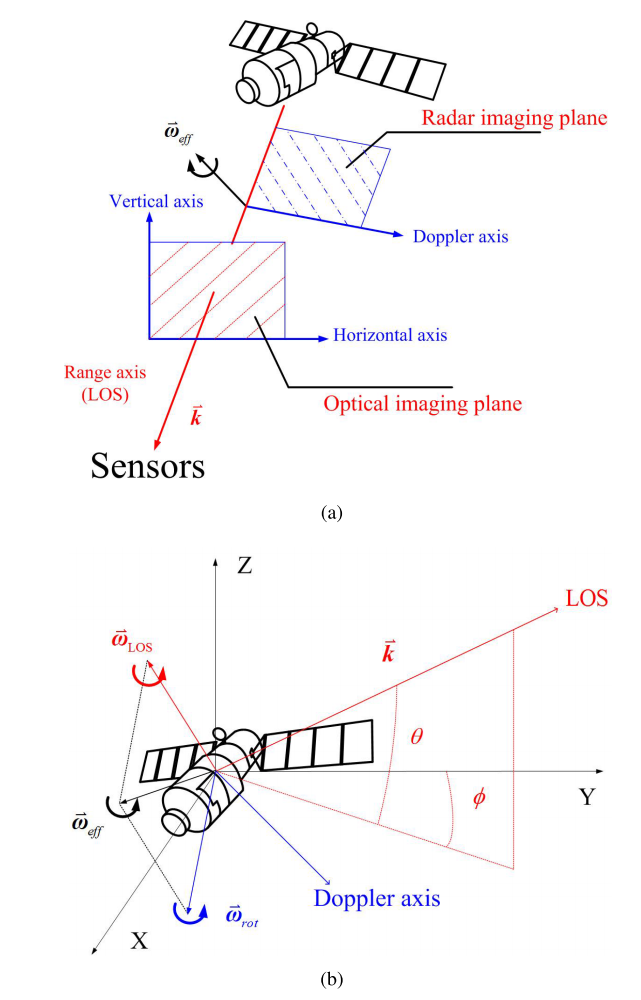
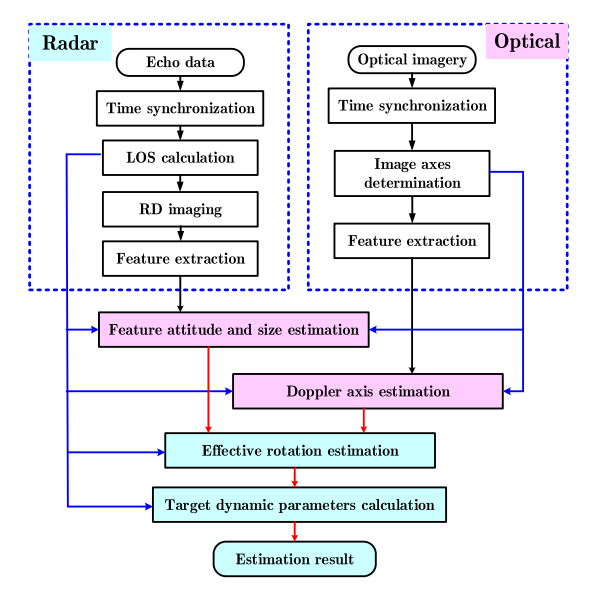
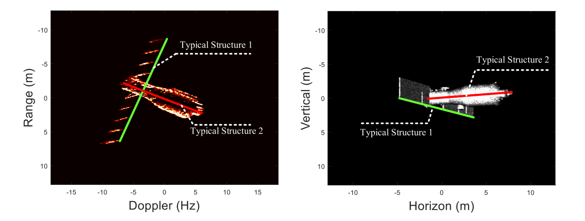
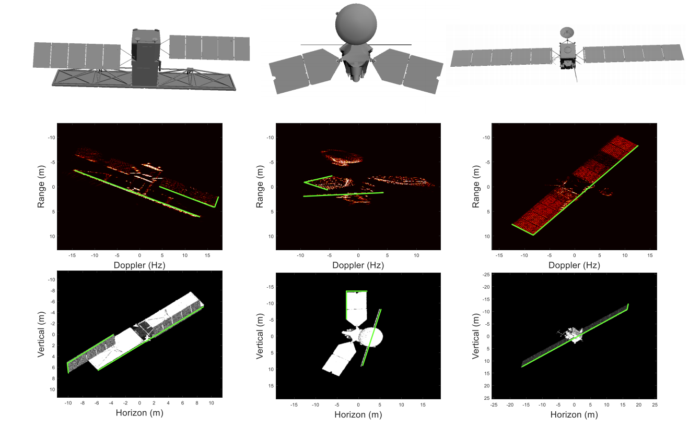
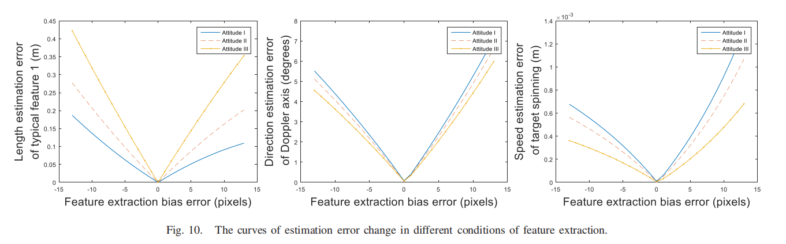

# 11.2周报

阅读论文：旋转卫星的光学与雷达图像融合动态估计

## 摘要

​	单一光学或雷达传感器通常只给出二维观测，已有三维动态估计往往依赖卫星结构、旋转模式或长期历史数据的先验。这篇论文用**同步光学图像和雷达 ISAR 图像**，把估计拆成目标姿态和旋转参数两步：先恢复结构特征的三维方向，再利用雷达多普勒信息估计旋转。作者通过仿真实验展示了方法的可行性。

## I. 引言

​	失去地面联系的卫星无法依赖自身遥测估计运动，只能靠外部观测。卫星激光测距方法需要角反射器和历史数据；只用 ISAR 图像与三维模型匹配的方法又需要已知旋转模式，才能完成方位定标。**单幅二维图像不足以独立确定三维运动**，这是本文引入两种传感器的原因。

​	贡献：在一个雷达相干处理间隔（CPI，即积累回波以形成一幅 ISAR 图像的时间窗）内，将光学成像时刻对齐到 CPI 中心。雷达距离向和光学图像的水平、竖直方向提供互补投影，可估计瞬时姿态；雷达多普勒向再用于估计自旋。论文还指出，对姿态稳定的卫星，前一部分也可用于估计瞬时姿态和结构尺寸。

## II. 估计模型

### A. 旋转卫星的观测几何

共址的光学设备和雷达从相近视角看目标，但成像方式不同：光学图像平面垂直于视线（LOS），雷达距离向沿视线；雷达另一维是回波频率变化形成的多普勒向。因此，雷达距离向与光学图像的两个轴合起来可提供三维结构信息。图 2 还给出了目标坐标系：$X$ 近似指向地心，$Y$ 沿轨道运动方向，$Z$ 垂直于轨道平面。

图 2 展示了光学平面、雷达成像平面与 LOS 的关系，也区分了轨道运动引起的视线变化和卫星自身旋转。

设当前 LOS 单位向量为 $\mathbf{k}$，仰角、方位角分别为 $\theta,\phi$；雷达与目标之间的等效角运动满足

$$
\mathbf{k}=(\cos\theta\sin\phi,\ \cos\theta\cos\phi,\ \sin\theta)^\mathsf{T},
\qquad
\boldsymbol{\omega}_{\mathrm{eff}}=\boldsymbol{\omega}_{\mathrm{LOS}}+\boldsymbol{\omega}_{\mathrm{rot}}.
$$

$\boldsymbol{\omega}_{\mathrm{LOS}}$ 来自轨道与观测几何变化，$\boldsymbol{\omega}_{\mathrm{rot}}$ 是目标自旋。模型假设**单个 CPI 内绕固定轴匀速旋转**；长期观测时，旋转轴和转速可以变化。

### B. 旋转卫星的动态估计

先选出太阳翼、主体等可辨认的线性结构。设某结构的三维向量为 $\mathbf l$，其雷达距离向、光学水平向和竖直向投影分别为 $r,u,v$。已知三个轴的方向后，用观测投影恢复该结构的方向和长度：

$$
\begin{bmatrix}r\\u\\v\end{bmatrix}
=
\begin{bmatrix}
\mathbf k_{R}^{\mathsf T}\\
\mathbf k_{U}^{\mathsf T}\\
\mathbf k_{V}^{\mathsf T}
\end{bmatrix}\mathbf l,
\qquad
\min_{\alpha,\beta,L}\bigl(\mathbf k_R\!\cdot\!\mathbf l-\hat r\bigr)^2+
\bigl(\mathbf k_U\!\cdot\!\mathbf l-\hat u\bigr)^2+
\bigl(\mathbf k_V\!\cdot\!\mathbf l-\hat v\bigr)^2.
$$

这里 $\mathbf l=L(\cos\alpha\sin\beta,\cos\alpha\cos\beta,\sin\alpha)^\mathsf T$；帽号是图像测量值。优化得到的是各结构的**瞬时三维姿态与长度**，还不是卫星自旋。

雷达多普勒轴 $\mathbf k_{F_d}$ 位于光学成像平面内，可写成 $\mathbf k_{F_d}=\cos\gamma\,\mathbf k_V+\sin\gamma\,\mathbf k_U$。对两条不同结构，论文利用多普勒投影长度之比消去未知等效转速：

$$
\min_{-\pi\leq\gamma\leq\pi}
\left|\frac{\cos\gamma\,\hat v_1+\sin\gamma\,\hat u_1}
{\cos\gamma\,\hat v_2+\sin\gamma\,\hat u_2}
-\frac{\hat d_1}{\hat d_2}\right|,
\qquad
\min_{\omega_{\mathrm{eff}}}\sum_{i=1}^{2}
\left(\omega_{\mathrm{eff}}\mathbf k_{F_d}\!\cdot\!\mathbf l_i-\hat d_i\right)^2.
$$

$d_i$ 是第 $i$ 条结构在雷达多普勒向的测量投影。先求多普勒轴方向 $\gamma$，再求等效转速 $\omega_{\mathrm{eff}}$，最后从等效角运动中扣除 $\boldsymbol{\omega}_{\mathrm{LOS}}$，得到自旋轴和转速。**至少需要两条可独立提取的结构特征**；一条特征无法用投影比消去转速。

## III. 基于同步光学与雷达图像的动态估计算法

图 4 概括了处理链：时间同步与成像、提取结构投影、估计结构姿态和尺寸、估计多普勒轴及等效转速，最后扣除轨道运动对应的视线变化。

### A. 图像预处理

​	光学曝光时刻需对准当前雷达 CPI 的中心。雷达跟踪系统提供经过大气修正的 LOS 方位角和仰角序列，据此分段成像并估计轨道引起的视线变化；光学校准提供像素分辨率与两个成像轴的方向。由于目标自旋未知，雷达图像**保留多普勒频率，不预先做方位向尺度定标**。文中的距离与多普勒分辨率分别写为 $\Delta r=c/(2f_s)$ 和 $\Delta f_d=1/\Delta T$；$f_s$ 是采样频率，$\Delta T$ 是该幅图像的积累时间。

### B. 特征提取

​	每条结构要在雷达图像上提取距离向、多普勒向长度，在光学图像上提取水平向、竖直向长度。多边形拟合、形态学或 Radon 变换可帮助自动提取，但雷达散射会随视角变化，出现幅度波动和边缘不连续，因此论文建议必要时人工辅助。后续估计对**长度提取误差**敏感。

### C. 参数估计算法

​	论文用粒子群优化（PSO，一种用粒子位置和速度迭代搜索最优解的方法）求解上述姿态、长度、多普勒轴和转速的优化问题。以结构姿态为例，粒子位置是 $(\alpha,\beta,L)^\mathsf T$，适应度就是三个投影残差的平方和；粒子根据自身最优解和全群最优解更新位置，达到迭代次数或移动阈值后停止。这里 PSO 是求解器，核心约束仍来自联合投影几何。

### D. 目标动态估计

​	**绝对姿态估计：**雷达距离轴和两个光学轴已知，逐条恢复结构的三维方向及长度。**旋转参数估计：**至少用两条结构确定未知的多普勒轴，再估计等效转速，扣除轨道运动对应的 LOS 变化。更多可用结构通常有助于提高估计精度。若只有一条线性结构，本文方法不能直接完成自旋估计；作者将多雷达视角作为后续可能方向。

## IV. 实验分析

​	实验全部使用**模拟图像**：根据公开 TLE 设置约 400 km 高度的轨道，北京地面站观测；光学图像用光线追踪生成，雷达 ISAR 图像用快速物理光学法生成，ISAR 信噪比设为 10 dB。表 I 给出的单幅图像为 $512\times512$，雷达距离分辨率为 0.05 m，光学分辨率为 $0.05\,\mathrm m\times0.05\,\mathrm m$。这组实验没有给出真实联合观测数据上的误差验证。

### A. 天宫一号的瞬时动态估计

以天宫一号（TG-I）的太阳翼和主体为两条结构。图 6 的同步 ISAR 与光学图像分别标出了对应投影；表 II 的一个 CPI 中，两条结构方向误差分别约 $0.53^\circ$、$0.54^\circ$，长度误差为 $0.1271$ m、$0.0971$ m；自旋轴方向误差 $2.1512^\circ$，转速估计 $0.0146$ rad/s，真值 $0.0141$ rad/s。另一 CPI 的表 III 也给出接近真值的估计，说明在这两组模拟成像条件下可行。

图 6 左侧是雷达距离-多普勒图，右侧是光学图。绿色和红色线条对应两条被提取的典型结构。

图 9 还展示了 RadarSat 组合体、火星勘测轨道器和 Rosetta 的模拟图像，说明这些示例中可以找到两条或更多可辨认结构；这并不等于所有卫星、所有视角都能稳定提取两条特征。

### B. 性能考察

#### 1. 误差分析

​	图 10 比较特征提取偏差对结构长度、多普勒轴方向和自旋转速的影响。论文报告，在所设三种姿态的仿真中，提取误差为 5 像素时，上述误差约为 $0.15$ m、$3^\circ$、$0.0004$ rad/s；不同姿态的曲线有差异。

​	同步误差实验把光学图像延迟设为 0、0.01、0.05 s。表 IV 中三组自旋转速误差分别为 0.0005、0.0004、0.0003 rad/s；在这组约 160 s 旋转周期的设定下，同步延迟的影响小于特征提取误差，不能据此忽略快速旋转目标的同步要求。

#### 2. 天宫一号长期图像序列的动态估计

​	在 100 s 内独立估计 10 个时刻，每次特征提取误差设为 3 像素；各 CPI 内轴和转速固定，跨 CPI 允许变化。表 V 中结构方向误差均小于 $3^\circ$，估计转速总体接近真值，但有的时刻转速误差达到约 $0.001$ rad/s。不同长度结构的长度误差不同；目标自旋与雷达成像平面的几何关系也会影响精度。表 V 的多普勒轴“指向误差”多次接近 $180^\circ$，与同表较小的自旋轴误差并列，阅读该指标时应留意轴向正负号的约定，论文未对此展开解释。

### C. 对比实验

​	在相同观测几何和五个 CPI 下，与文献 [21] 的 ISAR 图像序列方法比较。**姿态稳定目标：**两种方法都能估计结构姿态和长度；本文方法借助同步光学图像，仅需单幅 ISAR 的几秒 CPI，而序列方法在论文设置中需要超过 100 s 的观测。表 VI 中，本文方法的结构 1 方向误差约 $0.90^\circ$–$0.93^\circ$，序列方法为 $1.3971^\circ$。

​	**旋转目标：**以固定轴 $0.015$ rad/s 旋转时，表 VII 中本文方法的两条结构方向误差约 $0.82^\circ$–$1.43^\circ$；雷达序列方法的对应误差约 $18.42^\circ$–$76.16^\circ$。在该仿真设置中，后者受目标旋转导致的 ISAR 投影变化影响，不能正确恢复参数。这是针对所选对比方法和条件的结果。

### D. 讨论

​	论文认为联合观测所需设备可简化为一部雷达和一台光学望远镜：光学图像帮助恢复三维结构，雷达多普勒携带运动信息。方法成立仍依赖**清晰的光学图像、质量足够的雷达成像、同步观测和至少两条可提取结构**。分布式观测的扩展尚待研究。

## V. 结论

​	论文提出从同步光学与雷达图像估计旋转卫星动态参数的方法。通过联合成像投影几何，将目标动态参数与观测图像联系起来，并用 PSO 分阶段估计。仿真实验展示了该方法的可行性；相较所比较的已有方法，它缩短了所需观测时长，也不依赖目标长期历史数据。实际卫星联合观测中的效果仍需进一步验证。
