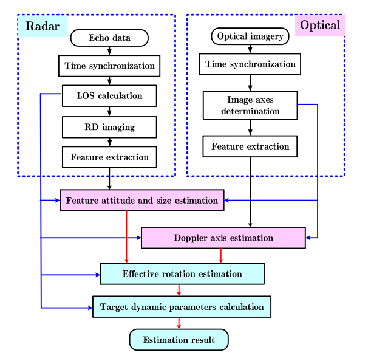
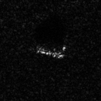
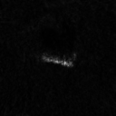

# 11.9周报

这两周我主要做了两件事：上周读了一篇关于旋转卫星光学与雷达联合估计的论文；这周把 MSTAR 数据整理成原版 3DGS 能读取的格式，并在自己的电脑上跑通了训练。目前跑通的是原版光学 3DGS。

## 上周：旋转卫星光学与雷达联合估计论文阅读

### 研究问题与方法

​	上周我读的是《旋转卫星的光学与雷达图像融合动态估计》。这篇论文要解决的问题是：只看一张光学图像或雷达图像，很难同时判断卫星结构在三维空间里的方向，以及卫星是怎么旋转的。以前有些方法需要事先知道卫星的三维模型或旋转方式，还有些方法需要观察较长时间。作者的思路是把**同一时刻的光学图像和雷达 ISAR 图像**结合起来，让两种图像提供互补的信息。

​	具体分两步

​	第一步，把拍摄光学图像的时刻对齐到雷达成像时间窗（CPI）的中心，找到太阳翼、卫星主体这类比较清楚的线性结构。光学图像提供水平和竖直两个方向的投影，雷达图像提供距离方向的投影，合起来估计这些结构的三维方向和长度。

​	第二步，看至少两条结构在雷达多普勒方向上的投影，估计旋转方向和转速，再扣除卫星轨道运动造成的视线变化，得到卫星自身的旋转参数。论文用粒子群优化分步骤求解。这里有个关键条件：图像里要能稳定找出**至少两条结构**，否则很难完成自旋估计。

图：从同步获取两类图像、提取结构投影，到估计姿态和旋转参数的流程。

### 实验结果与局限

​	作者用模拟图像做了验证：光学图像通过光线追踪生成，ISAR 图像通过快速物理光学法生成，雷达信噪比设为 10 dB。以天宫一号为例，论文选了太阳翼和主体两条结构。在一个 CPI 的结果中，两条结构的方向误差约为 $0.53^\circ$ 和 $0.54^\circ$，长度误差约为 0.13 m 和 0.10 m；自旋轴方向误差约为 $2.15^\circ$。估计转速是 0.0146 rad/s，真值是 0.0141 rad/s。

​	论文还测试了误差从哪里来。在这组模拟条件下，如果提取结构特征时偏差达到 5 像素，长度误差约为 0.15 m，多普勒轴方向误差约为 3°。和论文选用的雷达 ISAR 序列方法相比，联合观测方法只用一个持续数秒的 CPI，而对比方法需要超过 100 秒的观测。不过，这个比较只针对论文设定的目标和条件，不能直接推广到所有场景。

​	通过这篇论文，我进一步理清了观测角度、图像坐标和目标运动参数之间的关系。

## 本周：MSTAR 数据集与适配思路

​	这周我用的是 `17PNG_TRAIN.zip` 里的 MSTAR PNG 数据。压缩包有 10 类目标，共 2747 张 $128\times128$ 的灰度图。我先选了 2S1 这一类，它一共有 299 张。文件名像 `elev-17.0000-azim-10.2248-A.png`，可以从中读出 17° 高程角和方位角。但这份压缩包没有提供原版 3DGS 要用的透视相机参数和三维点云。

​	原版 3DGS 处理真实照片时，一般读取 COLMAP 标定的相机和稀疏点云；处理合成场景时，也可以读取 Blender 给出的相机矩阵。所以我写了两个独立的脚本，把数据整理成它认识的格式，原版的 `train.py`、渲染器和损失函数都没有改：

1. `mstar_to_3dgs.py`：先按方位角排序，再从 299 张 2S1 图像里每隔 3 张取 1 张，得到 100 张。根据文件名中的角度，把相机假设为绕目标运动，轨道半径设为 4、水平视场角设为 40°；另外随机生成 3000 个初始三维点。
2. `mstar_to_colmap.py`：把灰度值复制到 RGB 三个通道，再把前一步算出的虚拟相机位置、朝向和焦距写进 `sparse/0/images.txt`、`cameras.txt`，把初始点云写成 `points3D.ply`。这些文件只是借用了 COLMAP 的格式，不是 COLMAP 真正从图像重建出来的结果。

实际运行时加了 `--eval`，程序按文件名排序、每 8 张留 1 张测试，真正用到的是 **87 张训练图、13 张测试图**，而且全都是 17° 高程角的数据。

## 环境与训练过程

​	用自己的 RTX 3060 Laptop GPU 跑实验，显存是 6 GB，电脑上装了 CUDA Toolkit 12.6。为了编译和加载原版 3DGS 的 CUDA 扩展，我使用了匹配的 PyTorch 2.6.0+cu126。训练时加上 `--data_device cpu`，让输入图像放在内存里；渲染和参数优化还是由 GPU 完成。

​	先做了小规模运行检查，又跑了 2000 次迭代，确认流程没有问题后，把同一组数据训练到 **10000 次迭代**。增密阶段设在第 100 到 5000 次迭代。10000 次训练大约用了 85 秒；原版 3DGS 的默认设置是 30000 次，这次还没有跑到默认次数。

## 实验结果与分析

​	训练到 10000 次后，模型里有 **32191 个高斯点**，并输出了 13 张测试视角图。我把这 13 张渲染图和对应的真实图逐一比较：整张图的平均 PSNR 约为 **31.27 dB**；只看中间 $64\times64$ 的区域，平均 PSNR 约为 **27.13 dB**。两个数字差得比较多，是因为图像周围有大面积黑色背景。直接看渲染图，目标轮廓和散射亮点还是比较模糊，所以不能只看整图的 PSNR。

测试视角示例，真实图：

同一视角的原版 3DGS 渲染图：

​	这次实验至少说明：把小尺寸 MSTAR 图像整理成原版 3DGS 能读取的格式后，电脑能够把训练跑通。但这里用的相机半径、焦距和随机点云都不是 MSTAR 实测提供的参数；原版 3DGS 的透视渲染也没有处理 SAR 的斜距投影、随视角变化的散射和雷达阴影。

