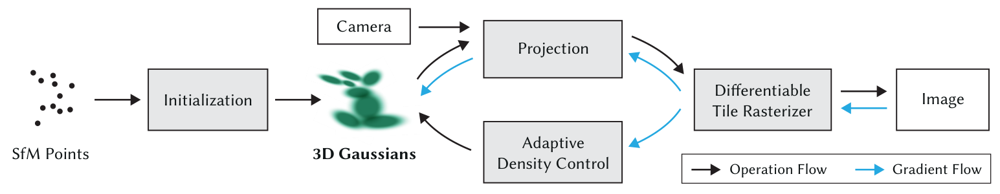
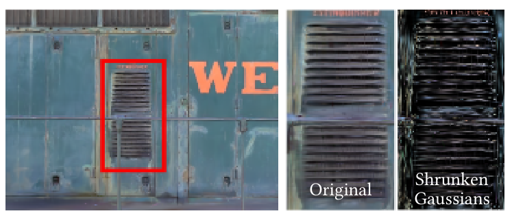
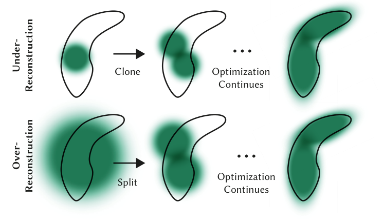
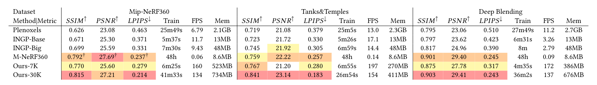
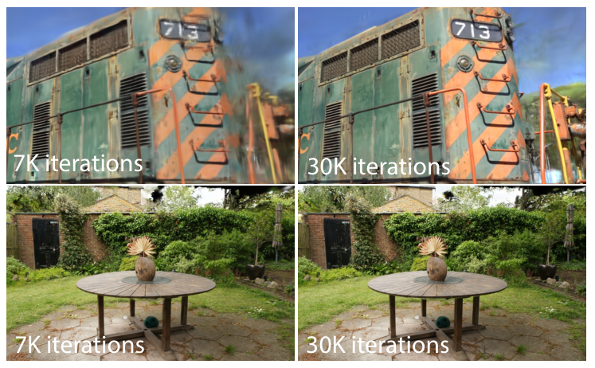
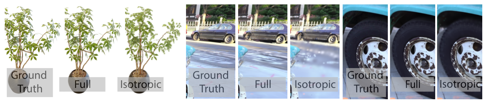
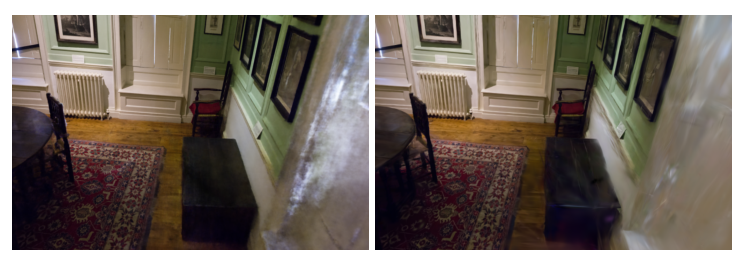

3DGS
================

## 摘要

辐射场方法最近对**多张照片**或**视频**拍摄的场景进行了新奇视角合成的革新。

三个关键要素可允许我们在保持有竞争力的训练时间的同时达到最先进的视觉质量，重要的是允许在1080p分辨率下进行高质量的实时(≥30 fps)新视点合成：

1\. 从相机标定过程中产生的稀疏点出发，用**3D高斯**来表示场景，它保留了用于场景优化的连续体积辐射场的良好特性，同时避免了在空空间中不必要的计算。

2\. 我们对3D高斯进行交错优化/密度控制，特别是优化各向异性协方差，以实现对场景的精确表示。

3\. 我们开发了一种支持各向异性抛雪球的快速可见性感知渲染算法，既加速了训练，又允许实时渲染。

关键词：新颖的视图合成，辐射场，3D高斯，实时渲染。

## **1.引言**

**背景：**

> 网格和点——显式、适合基于GPU / CUDA的快速栅格化
>
> 神经辐射场NeRF——在连续场景基础上、用Multi-Layer感知器，用于捕获场景的新视角合成

我们介绍了一种新的方法，它结合了这两个世界的优点：我们的3D高斯表示允许用最先进的( SOTA )视觉质量和竞争的训练时间进行优化，而我们的基于瓦片的抛雪球解决方案确保在先前发布的几个数据集上以1080p分辨率的SOTA质量进行实时渲染

**贡献：**

*   引入各向异性的3D高斯作为辐射场的高质量非结构化表示。
*   一种3D高斯特性的优化方法，与自适应密度控制交织在一起，为捕获的场景创建高质量的表示。
*   GPU的快速、可微分渲染方法，具有可见性感知，允许各向异性的抛雪球和快速反向传播，以实现高质量的新颖视图合成。

## **2.相关工作**

### 2.1 传统场景重建与渲染

SfM从多张照片中估计相机参数，得到稀疏点云；MVS进一步恢复稠密几何。已有方法利用这些几何将输入图像重新投影并混合到新视角，但难以处理几何缺失和错误重建的区域。

> SfM：运动恢复结构，恢复相机位置、朝向和部分三维点。
>
> MVS：多视图立体视觉，进一步恢复稠密几何。

### 2.2 神经渲染与辐射场

NeRF使用MLP表示场景，通过沿射线采样密度和颜色进行体渲染，图像质量较好，但大量采样和网络查询使计算成本较高。

Instant-NGP利用哈希网格加速，Plenoxels使用稀疏体素网格，不再依赖神经网络。它们加快了训练，但渲染仍需要查询大量采样点。

### 2.3 基于点的渲染与辐射场

直接渲染离散点容易产生空洞和锯齿，因此将点扩展为具有一定范围的圆盘、椭圆或椭球，再进行颜色混合。

**点的透明度混合与NeRF体渲染具有相同形式的图像合成模型，但渲染算法不同。**

$$
C=\sum_i T_i\alpha_i c_i,\qquad T_i=\prod_{j<i}(1-\alpha_j)
$$

> $c_i$：颜色；$\alpha_i$：当前像素处的有效不透明度。
>
> $T_i$：透射率，前面的内容遮挡后，还剩多少比例能看到后面的内容。

NeRF沿射线寻找采样点；3DGS直接将高斯投影到图像上，按前后顺序混合，减少采样开销。

## **3.方法概览**

输入是**静态场景的多张图像、SfM标定的相机和稀疏点云**。

从稀疏点创建3D高斯，优化位置、协方差、不透明度和球谐系数，并交替控制高斯的数量与分布。训练时使用快速、可微的图块渲染器，训练后用于实时新视角渲染。

图2：从SfM稀疏点初始化高斯，交替进行优化与密度控制。黑色箭头是操作流程，蓝色箭头是梯度流。

**流程：**稀疏点云 → 初始化高斯 → 投影与渲染 → 和真实图像比较 → 更新参数、增删高斯 → 重复训练。

## **4.可微3D高斯泼溅**

**选择高斯的原因：**可微，容易投影为二维斑点，能够通过透明度混合快速渲染，也不需要预先估计稀疏点的法线。

### 高斯表示

$$
G(x)=\exp\left[-\frac12(x-\mu)^T\Sigma^{-1}(x-\mu)\right]
$$

> $\mu$：中心位置；$\Sigma$：协方差矩阵，控制形状、大小和方向。
>
> 原文式（4）使用相对中心的坐标，这里显式写出$\mu$。

一个高斯保存**位置、尺度、旋转、不透明度和球谐颜色系数**。可以把它理解为中心贡献强、向外逐渐减弱的软团，不是有硬边界的实心球。

### 投影到二维

$$
\Sigma'=JW\Sigma W^TJ^T
$$

$W$表示视图变换的相关线性部分，$J$是投影局部仿射近似的雅可比矩阵。取对应的二维协方差，得到屏幕上的椭圆斑点。

**中心决定画在哪里，二维协方差决定斑点的大小和方向。**透视投影是非线性的，这里使用局部近似。

### 各向异性协方差

直接优化协方差可能产生无效矩阵，因此将它拆成缩放和旋转：

$$
\Sigma=RSS^TR^T
$$

$S$是缩放矩阵，$R$是旋转矩阵，旋转用归一化四元数表示。

> 各向同性：各方向尺度相同，形状像球。
>
> 各向异性：各方向尺度可以不同，可以拉长、压扁，更好地贴合表面和细小结构。

图3：右侧将高斯缩小60%，便于观察单个高斯的形状。缩小只是可视化操作。

### 球谐颜色

球谐函数SH用于表示**颜色随观察方向的变化**。固定RGB难以描述高光等视角相关效果，而球谐系数可以随训练调整。

零阶表示基础颜色，更高阶表示更复杂的方向变化。它拟合的是拍摄条件下的外观，不等于分别恢复了材质和光照。

## **5.结合自适应密度控制的高斯优化**

优化高斯的位置、协方差、不透明度和球谐系数，同时调整高斯数量，使场景表示从稀疏逐渐变得充分。

### 5.1 参数优化

不断渲染训练视角，并将结果与对应照片比较，通过反向传播更新参数。

**损失函数：**

$$
\mathcal{L}=(1-\lambda)\mathcal{L}_1+\lambda\mathcal{L}_{\mathrm{D\text{-}SSIM}},\qquad\lambda=0.2
$$

> L1比较像素数值，D-SSIM比较局部结构差异。

不透明度使用Sigmoid约束，尺度使用指数函数保持为正。初始高斯为各向同性，大小参考最近三个点的距离，位置学习率逐渐衰减。

**梯度**表示参数变化对误差的影响，**学习率**控制每次更新幅度。多视角图像共同约束高斯，但图像相似不代表几何一定完全准确。

### 5.2 高斯的自适应控制

预热后每100次迭代增密，并移除接近透明的高斯。以平均视图空间位置梯度作为增密依据，论文阈值为0.0002，再结合高斯大小选择克隆或分裂。

图4：上排覆盖不足时克隆，下排用一个大高斯表示细小结构时分裂。

**克隆：**小高斯所在区域覆盖不足，复制同样大小的高斯。论文描述为沿位置梯度方向移动副本，之后继续优化。

**分裂：**大高斯所在区域需要更多细节，用两个更小的高斯替换它。新位置从原高斯分布采样，尺度除以1.6。

**裁剪：**删除低不透明度或过大的高斯。

**不透明度重置：**每3000次迭代将不透明度降到接近零，让有用的高斯重新恢复贡献，便于清除漂浮伪影和多余高斯。

这里的“密度”指高斯数量的空间分布，不是NeRF的体密度。梯度大是增密的判断信号，不是直接测出的几何误差。

## **6.快速可微光栅化器**

目标是快速渲染和排序，支持各向异性高斯的透明度混合，并避免限制接收梯度的高斯数量。

**前向流程：**

1. 将屏幕划分为$16\times16$像素的图块。
2. 裁掉不影响视野或投影不稳定的高斯，计算二维投影。
3. 为高斯覆盖的每个图块建立条目。
4. 根据图块编号和深度进行一次GPU基数排序。
5. 每个图块并行处理像素，从前到后累积颜色和不透明度。
6. 像素接近完全不透明时，提前停止。

不再对每个像素单独排序，因此某些情况下的透明度混合是近似的。

**反向传播：**复用前向排序结果，从后向前遍历并恢复所需中间量，减少保存长列表的开销。不预先规定只有最前面的固定数量高斯能接收梯度。

**速度来源：**显式图元、图块并行、快速排序、共享数据和提前终止共同减少计算。

## **7.实现、结果与评估**

### 7.1 实现

使用Python和PyTorch实现优化，自定义CUDA核函数实现光栅化，使用NVIDIA CUB进行基数排序。交互查看器基于SIBR，用于浏览场景和测量帧率。

**优化细节：**先用较低图像分辨率预热，在250和500次迭代时提高分辨率。球谐从零阶开始，每1000次迭代增加一个频带，直到包含四个频带，以提高优化稳定性。

### 7.2 结果与评估

**实验设置：**13个真实场景和合成Blender数据集。真实场景包括Mip-NeRF360的9个场景、Tanks & Temples和Deep Blending各2个场景，每8张照片留出1张用于测试。

| 指标 | 含义 |
| --- | --- |
| PSNR ↑ | 基于像素误差的图像质量，越高越好。 |
| SSIM ↑ | 结构相似性，越高越好。 |
| LPIPS ↓ | 感知差异，越低越好。 |
| FPS | 每秒渲染帧数。 |
| Train | 训练时间。 |
| Mem | 优化后参数的存储量，不是训练峰值显存。 |

**真实场景：**

表1：带†的结果引用自原论文，其余来自作者实验。

在Mip-NeRF360数据集上，3DGS训练30K次迭代后，PSNR为27.21、SSIM为0.815、LPIPS为0.214，平均训练41分33秒，渲染134 FPS。质量接近高质量基线，渲染快很多，但不是每个指标都最好。

大部分实验使用A6000。Mip-NeRF360使用4张A100训练12小时，表中折算为单GPU的48小时，不是完全相同硬件条件下的实际耗时对比。

图6：部分场景在7K时已经较好，继续训练主要改善背景伪影；也有场景两者差别不明显。

**合成有界场景：**场景范围有限、相机准确、视角覆盖充分时，从10万个随机高斯开始也能训练出较好结果。30K的平均PSNR为33.32 dB，但不能由此认为复杂真实场景也不需要SfM初始化。

**紧凑性：**与一种已有点表示方法比较，达到相近PSNR时使用约四分之一的点数，模型平均3.8 MB，对方为9 MB。这是特定比较，不代表比所有NeRF方法都省存储。

### 7.3 消融实验

分别去掉一个设计，检查它对结果的影响。

**SfM初始化：**随机初始化主要使真实场景的背景变差，在观察不足的区域更容易产生漂浮高斯。

**增密：**分裂对背景细化较重要，克隆有助于细小结构更好、更快地收敛，两者互补。

**梯度数量：**只让最前面的10个高斯接收梯度，会使优化不稳定，Truck场景PSNR下降约11 dB。

**各向异性协方差：**允许不同方向有不同尺度，更容易贴合表面，在相同点数下提高质量。

图10：每组依次为真实图像、完整方法、各向同性。Ficus的两种设置都限制为不超过5K个高斯。

**球谐函数：**补偿视角相关外观，提高整体PSNR。

消融表3只使用Truck、Garden、Bicycle，并重新下采样输入图像，不能直接与表1当作完全相同设置比较。

### 7.4 局限

* 观察不足的区域会产生斑块、拉长或低细节的高斯。
* 较大高斯的裁剪和深度顺序变化可能造成画面跳变。
* 原方法没有加入正则化，额外约束可能改善未观察区域和跳变。
* 很大的场景可能需要降低位置学习率。
* 大场景训练峰值显存可能超过20 GB，渲染也要存下完整模型和额外缓冲。

图12：与训练视角重叠较少时，两种方法都会出现伪影。左为Mip-NeRF360，右为3DGS。

## **8.讨论与结论**

三维高斯保留了体渲染适合优化的特性，同时支持快速泼溅光栅化。结合高斯参数优化、自适应密度控制和GPU渲染设计，可以兼顾图像质量、训练效率和实时显示。

后续方向包括将更多优化逻辑移到CUDA、压缩模型，以及从高斯表示中恢复网格。

