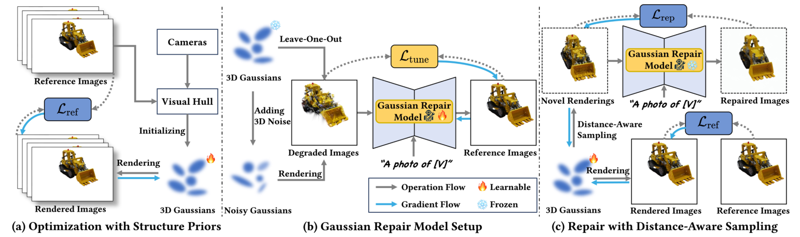
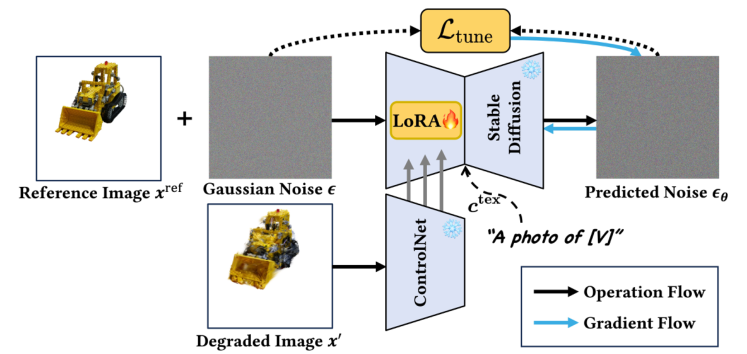
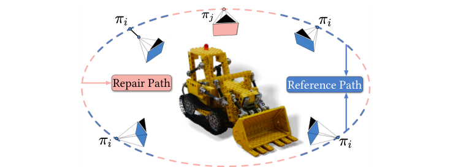
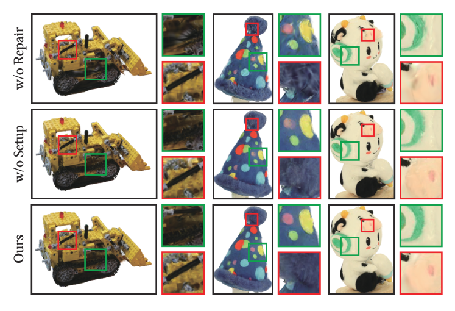
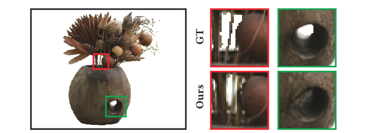
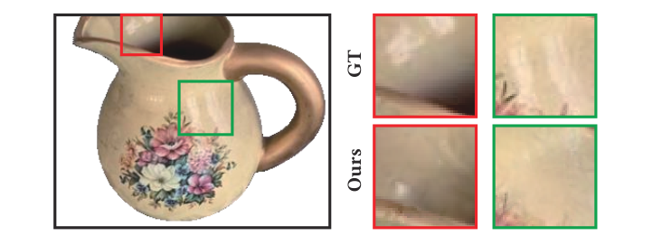

GaussianObject
================

## 摘要

从极少视角重建和渲染3D物体面临两个主要挑战：**图像太少，难以建立多视角一致性；视角覆盖不足，部分物体信息缺失或被严重压缩。**

GaussianObject使用高斯泼溅表示和渲染物体，仅用4张输入图像获得较高质量的重建：

1. 引入**视觉外壳和漂浮高斯清除**，将结构先验加入初始优化，帮助建立多视角一致性，得到粗高斯表示。
2. 构建基于扩散模型的**高斯修复模型**，补充遗漏信息，进一步优化高斯。通过自生成策略构造修复模型需要的训练图像对。
3. 提出**免COLMAP版本**，不需要预先提供准确相机位姿，方便实际使用。

关键词：稀疏视角重建、3D高斯泼溅、ControlNet、视觉外壳、新视角合成。

## **1.引言**

**背景：**通常需要拍摄几十张多视角照片才能获得较好的3D重建。减少拍摄数量，有助于降低3D资产制作和AR/VR应用的使用门槛。

**问题：**

* 极少视角下，模型容易过拟合输入图像，退化成各个训练视角的碎片化像素块，缺少合理的三维结构。
* 物体某些区域没被拍到，或只在很倾斜的角度下被观察，细节信息很少，仅靠输入照片难以恢复。

> 多视角一致性：不同角度看到的结果，应能由同一个三维物体解释。
>
> 结构先验：提前提供物体大致形状、范围等约束，缩小可能的重建结果。

**贡献：**

* 使用显式结构先验优化极稀疏视角下的3D高斯，包括视觉外壳初始化和训练时的漂浮高斯清除。
* 提出基于扩散模型的高斯修复模型，减少信息缺失或压缩造成的伪影，提高渲染质量。
* 在多个真实数据集上取得较好的定性和定量结果，并提供免COLMAP版本，降低对准确相机位姿的依赖。

## **2.相关工作**

**稀疏视角NeRF：**已有方法利用SfM深度、单目深度、语义一致性或正则化补充约束，但可能依赖相近视角、额外深度数据，或者难以恢复细节。部分先验只适合特定场景。

**扩散模型与3D重建：**预训练二维扩散模型可以提供图像先验，用于3D生成或指导重建。SDS等方法将扩散先验传递给三维表示，但生成效果与真实物体的一致性仍需要约束。

> 扩散模型：通过学习去噪过程生成图像。
>
> SDS：分数蒸馏采样，利用预训练扩散模型提供的信号优化三维表示。

**大重建模型LRM：**通过大规模预训练，直接预测三维表示，生成速度快，但部分方法对视角分布和物体位置有要求，处理随手拍摄的真实物体仍有困难。

**稀疏视角3DGS：**原始3DGS在极稀疏360°输入下同样容易失败，一些改进方法仍依赖SfM点。GaussianObject通过结构先验初始化和图像修复，减少对稠密输入及SfM点的依赖。

## **3.方法**

### 3.1 预备知识

**3D Gaussian Splatting：**每个高斯由中心位置$\mu$、旋转四元数$q$、尺度$s$、不透明度$\sigma$和球谐系数$sh$组成，所有高斯共同表示物体。

> 本文的$\sigma$表示高斯不透明度，不是NeRF中的体密度。

**ControlNet：**在扩散模型中加入图像条件，让生成结果受到输入图像约束。潜在扩散模型先用VAE将图像编码到潜空间，再进行加噪和去噪，最后解码回图像。

> VAE：变分自编码器，负责图像与潜在表示之间的转换。
>
> 潜空间：压缩后的特征空间，不直接在原始像素上完成全部运算。

式（1）的核心是预测加入潜变量中的噪声：

$$
z_t=\sqrt{\bar\alpha_t}z_0+\sqrt{1-\bar\alpha_t}\epsilon
$$

$$
\mathcal{L}_{\mathrm{Cond}}
=\mathbb{E}\left[\|\epsilon_\theta(z_t,t,c_{\mathrm{tex}},c_{\mathrm{img}})-\epsilon\|_2^2\right]
$$

$z_0$是原图的潜变量，$t$是噪声等级，$\epsilon$是实际加入的噪声，$\epsilon_\theta$是预测噪声。$c_{\mathrm{tex}}$和$c_{\mathrm{img}}$分别是文本与图像条件。

### 3.2 整体框架

输入为围绕一个物体拍摄的少量图像，以及对应的**相机内外参和物体掩码**。标准版本需要相机参数，免COLMAP版本再放宽这一要求，并不是直接省掉相机估计。

图2：左侧用结构先验得到粗高斯；中间生成退化图像对，训练修复模型；右侧冻结修复模型，用修复图像和真实图像继续优化高斯。

**流程：**视觉外壳初始化 → 初始优化与漂浮清除 → 生成退化图像对 → 微调修复模型 → 采样新视角并修复 → 继续优化高斯。

### 3.3 结构先验辅助的初始优化

4张照片往往难以生成可靠的SfM点云，也容易让形状和外观互相混淆。作者利用物体轮廓约束初始范围，再清除偏离主体的高斯。

**视觉外壳初始化：**

利用相机参数和各视角的物体掩码构造视觉外壳，作为高斯初始化的几何支架。随机采样三维点，将它们投影到所有输入图像，只保留投影均落在物体掩码内的点。

> 掩码Mask：标记图像中哪些像素属于物体，本文使用SAM获取。
>
> 视觉外壳Visual Hull：由多视角轮廓约束得到的大致三维体积；轮廓不能完整表达物体内部凹陷。

点的颜色取各视角投影颜色的平均值，并转换为球谐系数；尺度参考邻点距离，旋转初始化为单位四元数，不透明度设为常数。

**漂浮高斯清除：**

对每个高斯，用KNN计算到最近$\sqrt{P}$个高斯的平均距离，$P$为高斯数量。根据所有平均距离的均值和标准差设定阈值：

$$
\tau=\mathrm{mean}+\lambda_e\mathrm{std}
$$

平均邻点距离超过阈值的高斯被删除。训练中周期性执行，并将$\lambda_e$线性减小到0，使清除逐渐严格。

> KNN：寻找最近的若干邻居。这里把明显远离主体点群的高斯看作疑似漂浮点。

**初始优化损失：**

$$
\mathcal{L}_{\mathrm{ref}}
=(1-\lambda_{\mathrm{SSIM}})\mathcal{L}_1
+\lambda_{\mathrm{SSIM}}\mathcal{L}_{\mathrm{D\text{-}SSIM}}
+\lambda_m\mathcal{L}_m+\lambda_d\mathcal{L}_d
$$

* **颜色损失：**L1和D-SSIM，使渲染图像接近真实照片。
* **掩码损失：**二元交叉熵BCE，使渲染轮廓接近输入掩码。
* **深度损失：**使归一化后的渲染深度接近单目估计深度。

深度分别减去各自中位数，再除以相对中位数的平均绝对偏差：

$$
D^*=\frac{D-\mathrm{median}(D)}
{\frac1M\sum_{i=1}^{M}|D_i-\mathrm{median}(D)|},
\qquad
\mathcal{L}_d=\|D^*-D^*_{\mathrm{pred}}\|_1
$$

$M$是有效像素数。这样减少单目深度的尺度和整体偏移差异，主要约束相对几何关系，不把估计深度当作准确测量值。

### 3.4 高斯修复模型的构建

粗高斯在遮挡、少观察和未观察区域仍有缺失。修复模型$\mathcal{R}$接收有缺陷的渲染图像，生成更完整的图像，再用这些图像指导高斯优化。

**修复的是渲染图像，再通过监督更新三维高斯，不是扩散模型直接输出高斯参数。**

**训练图像对：**缺少“退化图像—真实图像”配对数据，因此采用两种自生成策略。

1. **留一法：**从$N$张输入图像构建$N$个子集，每次用$N-1$张训练粗高斯，将剩下的一张作为留出图像。随后加入留出图像继续训练，保存不同阶段在该视角的渲染结果，与真实留出图像配对。
2. **三维扰动：**统计加入留出图像前后高斯属性的变化，用其均值和方差构造噪声，加到粗高斯属性上。再从参考视角渲染，获得更多退化图像，与原照片配对。

留一法中的图像属于输入训练图像，不是最终评估用的测试真值。这里的三维属性扰动，也不同于扩散模型训练时加入潜变量的噪声。

**修复模型微调：**

在预训练ControlNet中加入LoRA，使用生成的图像对微调文本编码器、图像条件分支和U-Net中的相关层。物体文本提示为“a photo of [V]”，其中[V]用于表示目标物体。

> LoRA：低秩适配，在冻结主体权重的基础上，训练少量新增参数，让模型适应当前物体和修复任务。

图3：真实图像加噪后，与对应的退化图像一起输入带LoRA的ControlNet，用预测噪声与真实噪声的差异训练LoRA。

$$
\mathcal{L}_{\mathrm{tune}}
=\mathbb{E}\left[\|\epsilon_\theta(x_t^{\mathrm{ref}},t,x',c_{\mathrm{tex}})-\epsilon\|_2^2\right]
$$

$x'$为退化渲染图像，$x_t^{\mathrm{ref}}$表示参考图像对应的加噪表示。目标是学会依据退化渲染恢复当前物体的外观，而不是任意生成一个同类别物体。

### 3.5 距离感知采样下的高斯修复

参考视角附近信息较多，远离参考视角的地方更需要修复。作者围绕物体建立椭圆相机路径，分为参考路径和修复路径，从修复路径随机采样新视角。

图4：蓝色为参考路径，红色为修复路径。采样和加权都考虑新视角与参考视角的距离。

**修复过程：**渲染新视角图像$x_j$，编码到潜空间；一份作为图像条件，另一份加噪。通过DDIM去噪并解码，得到修复图像$\hat{x}_j$。训练好的修复模型在此阶段冻结，只继续优化高斯。

> DDIM：一种扩散采样方法，用若干去噪步骤生成结果。这里从加噪后的渲染图像出发，保留原有结构作为约束。

**修复损失：**

$$
\mathcal{L}_{\mathrm{rep}}
=\mathbb{E}_{\pi_j,t}\left[
w(t)\lambda(\pi_j)
\left(\|x_j-\hat{x}_j\|_1+\|x_j-\hat{x}_j\|_2+L_p(x_j,\hat{x}_j)\right)
\right]
$$

$$
\lambda(\pi_j)=\frac{2\min_i\|\pi_j-\pi_i\|_2}{d_{\max}}
$$

$L_p$是LPIPS感知差异，$w(t)$与噪声等级有关，$d_{\max}$是相邻参考视角之间的最大距离。按此公式，离最近参考视角越远，距离权重越大。

修复时仍保留真实参考图像上的$\mathcal{L}_{\mathrm{ref}}$，避免模型只追随生成图像而偏离输入物体。修复图像是额外监督，不是新获得的真实观测。

### 3.6 免COLMAP版本 CF-GaussianObject

标准稀疏视角方法经常使用由较密集照片估计的准确相机参数，这在实际只拍4张照片时并不方便。CF-GaussianObject使用DUSt3R，从输入图像估计粗点云、相机位姿和内参。

> DUSt3R：从图像中预测几何对应与三维信息的模型，用来提供点云和相机估计。

**流程：**

1. 修改DUSt3R的内参恢复，使输入图像共享同一内参。
2. 用视觉外壳约束预测点云，初始化高斯。
3. 利用参考图像和预测点云渲染的深度，联合优化高斯与相机位姿。
4. 用正则项限制位姿偏离初始估计，之后进入同样的修复模型训练和高斯修复流程。

免COLMAP不是不需要相机参数，而是由模型估计并优化，不再要求提前提供准确标定。

## **4.实验**

### 4.1 实现细节

框架基于3DGS和threestudio。单目深度使用ZoeDepth，修复骨干为Stable Diffusion v1.5上的ControlNet-Tile。

| 阶段 | 设置 |
| --- | --- |
| 粗高斯优化 | 10K次迭代，每500次清除漂浮高斯。 |
| 修复模型微调 | 1800步，LoRA秩为64，学习率$10^{-3}$。 |
| 高斯修复优化 | 再训练4K次迭代。 |
| 前2800次修复优化 | 同时使用真实图像和修复图像，修复损失权重从1.0衰减至0.1。 |
| 最后1200次 | 只使用真实参考图像。 |

4张输入、$779\times520$分辨率下，RTX 3090上的完整过程约30分钟。论文提到的粗高斯约1分钟，不是整个方法的训练时间。

### 4.2 数据集

使用Mip-NeRF360、OmniObject3D和OpenIllumination评估稀疏360°物体重建，改变输入视角数量进行比较。另用iPhone 13拍摄日常物体，每个物体4张图像，测试免COLMAP版本。目标物体掩码由SAM获取。

这里关注物体及其掩码区域，不应将结果直接与原始3DGS论文的完整场景指标比较。

### 4.3 评估

**稀疏360°重建：**与原始3DGS、DVGO、DietNeRF、RegNeRF、FreeNeRF、SparseNeRF、ZeroRF、FSGS等比较。原始3DGS采用随机初始化；为使FSGS适用于极稀疏设置，额外提供了SfM点。

表2中4视角结果摘录如下，LPIPS已从论文的$\mathrm{LPIPS}^*=100\times\mathrm{LPIPS}$还原：

| 数据集 | 方法 | LPIPS ↓ | PSNR ↑ | SSIM ↑ |
| --- | --- | ---: | ---: | ---: |
| Mip-NeRF360 | 3DGS | 0.1080 | 20.31 | 0.8991 |
| Mip-NeRF360 | FSGS | 0.0951 | 21.07 | 0.9097 |
| Mip-NeRF360 | GaussianObject | 0.0498 | 24.81 | 0.9350 |
| Mip-NeRF360 | CF-GaussianObject | 0.0847 | 21.39 | 0.9014 |
| OmniObject3D | 3DGS | 0.0860 | 17.29 | 0.9299 |
| OmniObject3D | GaussianObject | 0.0207 | 30.89 | 0.9756 |
| OmniObject3D | CF-GaussianObject | 0.0262 | 28.51 | 0.9669 |

> PSNR比较像素误差，SSIM比较结构相似性，LPIPS比较感知差异。前两项越大越好，LPIPS越小越好。

GaussianObject在这些设置下明显改善感知质量，6和9视角时也有较好表现。在OpenIllumination的4视角实验中，PSNR为24.64、SSIM为0.9354、LPIPS为0.0671；不是所有单项都最高，例如DietNeRF的SSIM为0.9361。

**与LRM比较：**比较TGS和LGM。TGS只接受单图；LGM对物体位置和相机角度有要求，因此分别测试直接使用4张照片，以及由单图生成符合要求视角的两种方式。GaussianObject在该真实数据设置下更好，但这些方法的输入条件不同，不能当作完全相同输入下的比较。

**CF-GaussianObject：**省去准确相机参数后，质量有所下降，但仍具有竞争力。论文观察到，与标准版本的差距会随输入视角增多而扩大，和DUSt3R估计精度有关。手机照片实验中，其他比较方法也使用DUSt3R预测相机参数。

### 4.4 消融实验

**关键组件：**在Mip-NeRF360的4视角设置下，分别去掉视觉外壳、漂浮清除、修复模型微调、修复过程和深度损失，并用SDS替换修复损失。

| 设置 | LPIPS ↓ | PSNR ↑ | SSIM ↑ |
| --- | ---: | ---: | ---: |
| 无视觉外壳 | 0.1272 | 15.95 | 0.8719 |
| 无漂浮清除 | 0.0499 | 24.73 | 0.9346 |
| 无修复模型微调 | 0.0553 | 24.28 | 0.9307 |
| 无高斯修复 | 0.0555 | 24.37 | 0.9297 |
| 无深度损失 | 0.0509 | 24.84 | 0.9341 |
| 使用SDS | 0.0607 | 22.42 | 0.9188 |
| 完整方法 | 0.0498 | 24.81 | 0.9350 |

视觉外壳影响最大。修复模型微调与修复过程都改善感知质量；漂浮清除的平均指标提升较小。深度损失主要略微改善LPIPS和SSIM，去掉后PSNR反而稍高，因此不能说每个组件都明显提高所有指标。SDS在这里使优化不稳定，效果差于图像修复监督。

图8：上排不进行高斯修复，中排不微调修复模型，下排为完整方法。差异主要体现在观察不足区域的伪影和细节。

**修复模型结构：**比较DreamBooth、深度条件ControlNet、带掩码的深度条件和Zero123-XL。只使用语义信息难以保证多视角结构，粗深度也会带来伪影。本文用退化渲染作条件，并针对当前物体微调，在该实验中更好地兼顾结构与细节。

> DreamBooth：用少量目标图像使扩散模型学习特定对象；Zero123-XL是单图条件的新视角生成模型。

**输入视角数量：**在Mip-NeRF360的kitchen场景上，不同视角数量下均优于原始3DGS。24个视角时达到与使用全部243个视角的3DGS接近的表现，这是该场景的实验结果，不是任意场景都能按这个比例减少照片。

### 4.5 局限与未来工作

**生成幻觉：**完全没拍到或观察不足的地方，修复模型可能生成看起来合理但实际不存在的细节。

图12：模型把石质花瓶原本的孔洞填上了。视觉上完整，不代表真实几何正确。

**视角相关外观：**4张照片难以区分反光和物体本身颜色，模型可能把反射白光固定到表面，导致新视角下反光不正确。

图13：上方是真实图像，下方是重建结果。固定到表面的高光不能随视角正确变化。

**未来方向：**加入更多视角相关数据微调扩散模型；结合2DGS、GOF等表面重建方法；利用匹配置信度改善免COLMAP版本的相机估计。CF版本与准确相机参数下的结果仍存在差距。

## **5.结论**

GaussianObject基于3DGS，从极稀疏360°视角进行高质量物体重建，并保留实时渲染能力。

核心是两部分：**结构先验辅助优化，帮助建立多视角一致性；高斯修复模型，减少信息缺失或压缩造成的伪影。**免COLMAP版本进一步降低了实际拍摄和相机标定的要求，但缺失区域的真实性与相机估计误差仍是限制。
